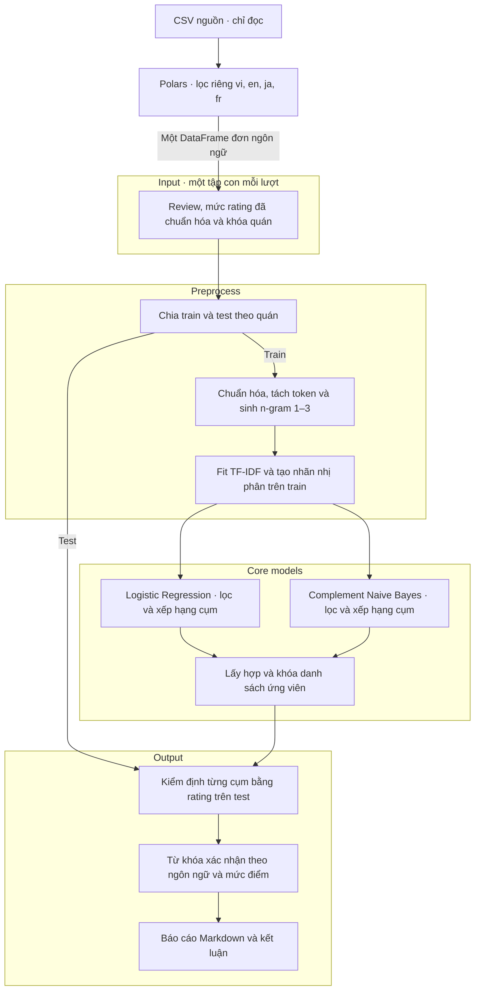

# Report 4 · Kế hoạch triển khai tìm từ khóa theo ngôn ngữ và mức điểm

## 1. Phạm vi và kết quả cần có

Pipeline giải bài toán nhị phân một mức so với tất cả mức còn lại để tìm cụm ứng viên cho từng ngôn ngữ và mức 0–5. Phép kiểm định thống kê trên rating thật của tập test xác nhận mối liên hệ giữa cụm và mức điểm.

Kết quả có một bảng tổng hợp theo `language × rating_level` và một bảng chi tiết theo `language × rating_level × phrase`. Tạo đủ sáu mức cho mỗi ngôn ngữ được phân tích, kể cả khi kết quả là chưa xác minh nhãn, thiếu mẫu, thiếu đối chứng hoặc không có cụm đạt ngưỡng. Gộp review từ các nguồn trong cùng ngôn ngữ để huấn luyện và kiểm định. Phạm vi kết luận là tập review của ngôn ngữ đó trong dữ liệu dự án.

Ví dụ minh họa cho đầu ra là `en | 4 | lovely dishes | <trạng thái>`. Dữ liệu và phép xác nhận sẽ quyết định cụm nào xuất hiện trong bảng cuối. Trong báo cáo, “fatal keyword” chỉ cụm đã được xác nhận cho một mức rating. Với các mức ngoài mức 1, có thể gọi rõ là “từ khóa đặc trưng cho mức k”.

## 2. Dữ liệu và định nghĩa nhãn

Đọc CSV bằng Polars, từ thư mục `code/hung/data/preprocess_merged_data`. Dùng `reviews_preprocessed.csv` làm đầu vào phân tích và đọc trực tiếp `rating_level_5` làm nhãn mức 0–5 đã tiền xử lý. Dùng `restaurants.csv` khi cần metadata quán. Đối chiếu với CSV trước tiền xử lý và dữ liệu thô có thể truy vết qua `raw_object_key` khi audit. Kiểm tra lại số mẫu trên snapshot hiện tại và lưu hash. Phân tích này chạy từ CSV.

Audit nhãn ngôn ngữ và độ phủ theo mức điểm, ưu tiên review ngắn và nhãn suy ra. Ghi nhóm `unknown` trong audit. Chuẩn hóa về các mã ngôn ngữ đã xác minh trước khi chạy phân tích theo ngôn ngữ.

Snapshot `reviews_preprocessed.csv` có **384.059 review**, **43 giá trị** trong cột `language`, gồm **42 mã ngôn ngữ/biến thể** và `unknown`. Hai mã `zh-cn` (42 review) và `zh-tw` (44 review) được lưu riêng trong CSV. Nếu quy về mã ngôn ngữ gốc `zh`, tổng còn **41 mã ngôn ngữ gốc**. Số đếm phản ánh nhãn hiện có trong CSV, bao gồm các nhãn suy ra.

| Nhãn | Số review |
|---|---:|
| Việt (`vi`) | 278.247 |
| Anh (`en`) | 34.267 |
| Nhật (`ja`) | 30.569 |
| Pháp (`fr`) | 4.188 |
| 38 mã còn lại | 8.599 |
| Chưa xác định (`unknown`) | 28.189 |
| **Tổng** | **384.059** |

### Tạo tập con theo ngôn ngữ trước Input

Đọc `reviews_preprocessed.csv` ở chế độ chỉ đọc. Dùng Polars lọc riêng từng giá trị `language == "vi"`, `"en"`, `"ja"` và `"fr"` để tạo bốn DataFrame đơn ngôn ngữ trong bộ nhớ. **Input của mỗi lượt chạy là một DataFrame đơn ngôn ngữ.** CSV nguồn được giữ nguyên.

```python
import polars as pl

reviews = pl.read_csv("code/hung/data/preprocess_merged_data/reviews_preprocessed.csv")
language_datasets = {
    lang: reviews.filter(pl.col("language") == lang)
    for lang in ("vi", "en", "ja", "fr")
}

# Input cho lượt tìm từ khóa tiếng Anh
pipeline_input = language_datasets["en"]
```

Bốn tập con có tổng cộng **347.271 / 384.059 review** trước các bước kiểm tra tiếp theo. Có **36.788 review** ngoài phạm vi, gồm `unknown`, các mã khác và giá trị thiếu nếu có. Ghi số dòng nguồn và số dòng của từng tập con trong kết quả audit.

Sau khi nhận tập con đơn ngôn ngữ, pipeline chia train/test theo quán và fit từ vựng, IDF trên tập train của ngôn ngữ đó. Dùng cặp `(source_code, source_restaurant_id)` để phân biệt các quán có cùng ID giữa các nền tảng. Dùng cặp `(source_code, source_review_id)` làm khóa review. Nguồn phục vụ định danh và truy vết. Rà nhãn suy ra và review trộn ngôn ngữ trong bốn tập con. Việc train từng mức còn phụ thuộc số review và số quán hỗ trợ trong ngôn ngữ đó.

## 3. Pipeline tuần tự · Train nhị phân → trích cụm → kiểm chứng bằng rating thật

Mỗi lượt nhận một tập con đơn ngôn ngữ đã được Polars tạo trước Input. Trong tập con đó, mỗi lần huấn luyện xét một mức đích k. Đầu vào là văn bản review. Nhãn là `1` nếu `rating_level_5` bằng k và `0` nếu thuộc các mức hợp lệ còn lại của ngôn ngữ đó. Bắt đầu với tiếng Việt ở mức 1, rồi mở rộng sang từng ngôn ngữ và mức 0–5 có đủ hỗ trợ.

| Thuật toán | Cấu hình | Vai trò |
|---|---|---|
| Logistic Regression | TF-IDF + Logistic Regression L2 nhị phân | Xếp hạng ứng viên theo hệ số dương hướng về mức đích |
| Complement Naive Bayes | TF-IDF + Complement Naive Bayes nhị phân | Xếp hạng ứng viên theo chênh lệch đóng góp của n-gram vào điểm lớp đích và lớp còn lại |

TF-IDF chuyển văn bản thành đặc trưng số. Hai thuật toán học từ các đặc trưng đó và rating đã gắn nhãn. Lần chạy tiếng Việt ở mức 1 có hai mô hình cuối, một cho mỗi thuật toán. Tổng số mô hình là hai lần số tổ hợp ngôn ngữ–mức đủ hỗ trợ. Nếu cả bốn ngôn ngữ đều đủ mẫu ở mức 1–5 thì có 40 mô hình. Mỗi tổ hợp mức 0 đủ hỗ trợ bổ sung hai mô hình, với tối đa 48 mô hình nếu cả bốn ngôn ngữ đều đủ sáu mức. Các lượt cross-validation và baseline được tính riêng.

| Bước | Module | Việc cần làm và đầu ra |
|---|---|---|
| 1. Audit | `prepare.py` | Kiểm tra khóa review, ID quán, văn bản, rating và ngôn ngữ. Xuất mẫu đối chiếu raw và `rating_coverage.csv` theo ngôn ngữ và mức, kèm số review và số quán |
| 2. Khóa split | `prepare.py` | Nhận một DataFrame đơn ngôn ngữ đã lọc trước Input. Chuẩn hóa Unicode, HTML và khoảng trắng. Giữ dấu, phủ định và ranh giới câu. Che URL, thông tin cá nhân và cụm tiết lộ điểm. Chia khoảng 80/20 theo quán, giữ review dài trùng/gần trùng trong cùng nhóm chia tập. Tạo tối đa 5 fold theo nhóm trong tập train và lưu `split_manifest.csv` |
| 3. Train và xuất trọng số | `train.py` | Sinh n-gram 1–3 theo quy tắc tách token bên dưới. Fit vocabulary, IDF và classifier trong từng fold huấn luyện. Chọn cấu hình trên tập train rồi fit lại, xuất và kiểm tra nạp lại theo mục 5 |
| 4. Trích và khóa ứng viên | `discover.py` | Xếp hạng và lọc cụm từ từng mô hình trên train. Lấy hợp hai danh sách, gộp trùng và lưu `locked_candidates.csv` trước khi mở test |
| 5. Kiểm chứng trên test | `evaluate.py` | Dùng rating thật và cờ có cụm để kiểm định theo mục 4. Dự đoán của hai mô hình nhị phân phục vụ bảng so sánh thuật toán ở mục 5. Xuất `keyword_results.csv` và `test_metrics.csv` |
| 6. Báo cáo và kết luận | `report.py` | Xuất `keywords_by_language_rating.csv` và `REPORT_4_RESULTS.md` theo mục 6. Đọc mẫu ngữ cảnh ẩn danh từ nhiều quán để diễn giải kết quả |

Tái sử dụng manifest Report 3 khi khớp snapshot, phạm vi và quy tắc chia nhóm. Manifest lưu khóa review, nhóm chia tập, split, fold, seed và hash snapshot. Kiểm tra giao nhau của quán và nhóm văn bản trùng giữa các tập, cùng số quán có lớp đích trong từng fold.

### Sơ đồ pipeline



### Tách token và tạo cụm từ trước TF-IDF

Chuẩn hóa chữ thường và tách câu, sau đó tách mỗi câu thành token theo ngôn ngữ. Từ cùng một dãy token, sinh **unigram, bigram và trigram** bằng cửa sổ trượt. Các cửa sổ được phép chồng lên nhau và dừng ở ranh giới câu. Mỗi unigram hoặc cụm liên tiếp trở thành một ứng viên cho một cột TF-IDF.

Ví dụ, câu “I love this lovely dishes.” cho dãy token `i | love | this | lovely | dishes`.

| Độ dài | Đặc trưng sinh ra |
|---|---|
| 1 token | `i`, `love`, `this`, `lovely`, `dishes` |
| 2 token | `i love`, `love this`, `this lovely`, `lovely dishes` |
| 3 token | `i love this`, `love this lovely`, `this lovely dishes` |

Một review có thể kích hoạt đồng thời cột `love` và cột `lovely dishes`. TF-IDF tính giá trị cho từng cột. Cả hai mô hình học trọng số riêng cho các đặc trưng này. Các cửa sổ cũng sinh chuỗi như `this lovely`. Khi rà danh sách trên train, ưu tiên các cụm có nghĩa rõ khi đọc trong câu gốc và ghi lại lý do nếu loại ứng viên bị cắt cụt. Giữ thứ tự token khi sinh cụm để giữ các phủ định như `not good` và `không ngon`.

Tiếng Anh và tiếng Pháp dùng token theo từ. Tiếng Việt bắt đầu theo âm tiết để có thể sinh `giao hàng` và `giao hàng chậm`. Tiếng Nhật cần tách từ trước khi sinh n-gram. Fit vocabulary và IDF trên phần huấn luyện của từng lượt cross-validation, rồi fit lại trên toàn tập train sau khi chốt cấu hình. Khi kiểm chứng, dùng cùng bộ phân tích văn bản để xác định sự xuất hiện của cụm trên test. Một cụm được đếm tối đa một lần trong mỗi review khi lập bảng kiểm định.

### Trích ứng viên từ trọng số

Dùng tên đặc trưng và `classes_` để xác định cột n-gram và lớp đích. Với Logistic Regression, lấy hệ số hướng về lớp đích. Với Complement Naive Bayes, lấy trọng số đóng góp vào điểm lớp đích trừ trọng số đóng góp vào điểm lớp còn lại, theo quy ước điểm cao hơn được chọn. Xếp hạng riêng trong từng mô hình theo điểm dương hướng về lớp đích. Trên tập train, đếm cụm tối đa một lần mỗi review. Lưu tỷ lệ chứa cụm theo lớp, log-OR làm trơn, số review/quán và điểm của từng mô hình. Áp dụng cùng ngưỡng hỗ trợ đã chốt. Có thể thử ≥20 review lớp đích từ ≥5 quán làm cấu hình ban đầu.

Mỗi mô hình giữ tối đa `n` cụm cho mỗi tổ hợp ngôn ngữ–mức. Chốt `n` trên tập train trước khi xem test. **Lấy hợp hai danh sách** và gộp trùng theo ngôn ngữ, mức đích và cụm từ. Danh sách hợp có tối đa `2n` ứng viên. Mỗi tổ hợp duy nhất được khóa và kiểm định một lần. Số giả thuyết dùng cho Holm được tính từ danh sách hợp sau khi gộp trùng.

**Cơ sở chọn ngưỡng hỗ trợ.** Hai mốc 20 review và 5 quán là giá trị thử ban đầu trên tập train. Nhóm ghi số review lớp đích có cụm, số quán có các review đó và tỷ trọng của quán đóng góp nhiều nhất. Ví dụ 20 review từ 5 quán vẫn có thể phân bố 16–1–1–1–1, tức một quán chiếm 80%. Trước khi chốt ngưỡng, khảo sát phân bố hỗ trợ và thử độ nhạy với vài ngưỡng trên tập train. Ghi lại số cụm giữ được và mức độ tập trung theo quán, rồi khóa cấu hình trước khi mở test. Suy luận theo cụm có thể thiếu ổn định khi vài quán chi phối kết quả. [MacKinnon và cộng sự, 2023](https://doi.org/10.1016/j.jeconom.2022.04.001)

**Fold dùng để đánh giá mô hình trên tập train.** Nếu chạy 5-fold cross-validation theo quán, chia tập train thành 5 phần. Mỗi lượt huấn luyện trên 4 phần và kiểm tra trên phần còn lại. Luân phiên phần kiểm tra để mỗi quán chỉ thuộc một phần. Fit TF-IDF và classifier lại trong từng lượt. Có thể ghi số lượt hệ số dương và số lượt cụm có trong vocabulary để mô tả độ ổn định. Tiêu chí dấu dương 4/5 lượt là một lựa chọn thăm dò. Bước chọn ứng viên dùng điểm từ hai mô hình fit trên toàn tập train cùng ngưỡng hỗ trợ đã chốt. [Tài liệu GroupKFold](https://scikit-learn.org/stable/modules/generated/sklearn.model_selection.GroupKFold.html)

## 4. Kiểm chứng từ khóa trực tiếp bằng rating thật

### 4.1. Giả thuyết một phía dùng chung

Với mỗi tổ hợp đã khóa gồm ngôn ngữ, cụm từ và mức đích \(k\), dùng cùng quy tắc chuẩn hóa, tách token và sinh n-gram đã chốt để xác định review test có chứa cụm. Đặt \(p_1=P(Y=k\mid\text{có cụm})\) và \(p_2=P(Y=k\mid\text{không có cụm})\) trong cùng ngôn ngữ. Dùng chung giả thuyết:

$$
H_0:p_1\le p_2,
\qquad
H_1:p_1>p_2.
$$

Ví dụ với `lovely dishes → 4 sao`, giả thuyết đối hỏi liệu tỷ lệ **thật sự được chấm 4 sao** trong nhóm có cụm có cao hơn nhóm không có cụm hay không. Chốt hướng kiểm định, danh sách ứng viên và mức ý nghĩa \(\alpha=0.05\) trước khi mở test.

| Review test | Rating thật bằng \(k\) | Rating thật khác \(k\) |
|---|---:|---:|
| Có cụm | \(a\) (TP) | \(b\) (FP) |
| Không có cụm | \(c\) (FN) | \(d\) (TN) |

Quy ước lớp dương là **rating bằng \(k\)**. Nếu dùng sự xuất hiện của cụm làm quy tắc dự đoán, bảng trên là **confusion matrix cho từng cụm**. Có cụm dự đoán mức \(k\), còn không có cụm dự đoán mức khác. Lưu TP, FP, FN và TN cùng các chỉ số:

- Precision \(=a/(a+b)\). Tỷ lệ rating đúng mức đích trong nhóm có cụm.
- Recall \(=a/(a+c)\). Tỷ lệ review ở mức đích chứa cụm.
- F1 \(=2a/(2a+b+c)\).
- Accuracy \(=(a+d)/(a+b+c+d)\). Báo thêm tỷ lệ của lớp đa số để đối chiếu.

Các chỉ số này mô tả quy tắc dự đoán bằng một cụm. Kết quả phân loại của Logistic Regression và Complement Naive Bayes nằm trong bảng ở mục 5.

**Odds ratio (OR)** so sánh odds đạt mức \(k\) giữa nhóm có và không có cụm. Odds của một xác suất \(p\) là \(p/(1-p)\). Với bảng có đủ bốn ô dương, \(\widehat{\mathrm{OR}}=(a/b)/(c/d)=ad/(bc)\). Báo cả hai tỷ lệ và chênh lệch điểm phần trăm để diễn giải độ lớn của liên hệ.

Tính \(\hat p_1=a/(a+b)\), \(\hat p_2=c/(c+d)\), chênh lệch \(100(\hat p_1-\hat p_2)\) theo điểm phần trăm và odds ratio (OR). Khi hai tỷ lệ nằm trong \((0,1)\), \(p_1=p_2\) tương ứng với \(\mathrm{OR}=1\), còn \(p_1>p_2\) tương ứng với \(\mathrm{OR}>1\). Vì vậy, phép kiểm định trên log-OR dùng mốc biên \(\log(1)=0\) và lấy đuôi phải.

### 4.2. Kiểm định Wald \(z\) một phía với sai số chuẩn theo quán

Gọi \(a_g,b_g,c_g,d_g\) là bốn ô đếm của quán \(g\). Nếu manifest đã nối nhiều quán do review trùng, dùng nhóm đã nối làm đơn vị tính sai số chuẩn. Gọi \(G\) là số nhóm trên test và \(a,b,c,d\) là tổng từng ô qua các nhóm.

1. Tính \(\widehat{\mathrm{OR}}=ad/(bc)\) và \(\hat\theta=\log(\widehat{\mathrm{OR}})\). Phép kiểm định dùng mốc biên \(H_0:\theta=0\).
2. Dùng phương pháp delta để ước lượng sai số chuẩn của log-OR từ đóng góp của từng nhóm. Các review cùng quán được gộp trước khi tính độ dao động.

$$
u_g=\frac{a_g}{a}-\frac{b_g}{b}-\frac{c_g}{c}+\frac{d_g}{d},
\qquad
SE_{\mathrm{cluster}}=
\sqrt{\frac{G}{G-1}\sum_{g=1}^{G}u_g^2}.
$$

3. Tính \(z_0=\hat\theta/SE_{\mathrm{cluster}}\) và \(p_{\mathrm{raw}}=1-\Phi(z_0)\), với \(\Phi\) là hàm phân phối chuẩn tắc. Khoảng tin cậy 95% hai phía của OR là \(\exp(\hat\theta\pm1.96\,SE_{\mathrm{cluster}})\). Dùng p-value thô này cho bước Holm ở mục 4.3.

Phép tính dùng bảng đếm theo từng quán và xấp xỉ chuẩn khi có đủ nhóm độc lập đóng góp thông tin. Nếu có ô tổng bằng 0, thiếu nhóm hỗ trợ hoặc sai số chuẩn bằng 0, báo số liệu mô tả và trạng thái chưa đủ bằng chứng. Kiểm tra mức độ tập trung trước khi diễn giải kết quả, vì vài quán có thể chi phối ước lượng. [Cameron và Miller](https://cameron.econ.ucdavis.edu/research/Cameron_Miller_Cluster_Robust_October152013.pdf)

### 4.3. Hiệu chỉnh Holm cho nhiều p-value

**Vì sao cần hiệu chỉnh trong Report 4?** Mỗi lần kiểm định ở mức ý nghĩa \(0.05\) có xác suất bác bỏ nhầm tối đa 5% khi \(H_0\) đúng. Report 4 kiểm định nhiều cụm trên nhiều mức điểm. Mỗi phép kiểm định bổ sung tạo thêm cơ hội kết luận nhầm rằng một cụm đặc trưng cho mức điểm đích. Ví dụ minh họa, nếu kiểm định 20 cụm độc lập, cả 20 giả thuyết không đều đúng và mỗi phép có xác suất bác bỏ nhầm đúng 5%, thì xác suất có ít nhất một kết luận nhầm là:

$$
1-(1-0.05)^{20}\approx 0.642.
$$

Con số **64,2%** minh họa trường hợp độc lập. Trong dữ liệu review, nhiều cụm có thể xuất hiện cùng nhau nên các phép kiểm định có thể phụ thuộc. Holm kiểm soát rủi ro của **cả danh sách cụm được xác nhận** ở mức 5% khi các p-value đầu vào hợp lệ, kể cả khi các phép kiểm định phụ thuộc. Việc khóa ứng viên trên tập train và kiểm tra trên test giúp tách bước chọn cụm khỏi bước xác nhận. Holm xử lý việc xác nhận nhiều cụm ngay trên tập test. [Tài liệu R về hiệu chỉnh p-value](https://stat.ethz.ch/R-manual/R-devel/library/stats/html/p.adjust.html)

**Holm** (Holm–Bonferroni) là phương pháp hiệu chỉnh p-value theo thứ tự tăng dần khi kiểm định nhiều giả thuyết. Với các p-value đầu vào hợp lệ, Holm kiểm soát **xác suất bác bỏ nhầm ít nhất một \(H_0\) thực sự đúng** trong cả họ kiểm định (family-wise error rate, FWER) ở mức \(\alpha\). Điều này áp dụng cả khi các phép kiểm định phụ thuộc nhau, chẳng hạn hai cụm cùng xuất hiện trong nhiều review. [Holm, 1979](https://www.jstor.org/stable/4615733) · [Tài liệu R về hiệu chỉnh p-value](https://stat.ethz.ch/R-manual/R-devel/library/stats/html/p.adjust.html)

**Khi nào cần dùng Holm?**

| Tình huống | Quy tắc |
|---|---|
| Chỉ có **một giả thuyết xác nhận** trong họ đã chốt trước khi mở test, ví dụ chỉ kiểm định cụm “lovely dishes” cho mức 4 trong tập tiếng Anh | Dùng p-value thô của phép kiểm định hợp lệ và so với \(0.05\). Với \(m=1\), công thức Holm cho \(p^{\mathrm{Holm}}=p_{\mathrm{raw}}\). |
| Có **từ hai giả thuyết xác nhận trở lên** trong cùng họ và muốn kiểm soát rủi ro báo nhầm ít nhất một kết quả trong cả họ | Hiệu chỉnh Holm trên toàn bộ p-value thuộc họ đã chốt. Áp dụng cả khi nhiều phép dùng cùng cụm nhưng khác ngôn ngữ hoặc mức đích, và cả khi cuối cùng chỉ công bố một kết quả được chọn từ các phép đã chạy. |
| Chỉ mô tả hoặc thăm dò, ví dụ xếp hạng ứng viên trên tập train hoặc báo tỷ lệ xuất hiện | Không cần Holm nếu chỉ báo số liệu mô tả hoặc kết quả thăm dò, chưa dùng p-value để tuyên bố cụm đã được xác nhận. |

Trong Report 4, chốt họ kiểm định trước khi mở test theo phạm vi kết luận cần công bố. Nếu công bố một danh sách chung cho nhiều ngôn ngữ và mức điểm, hiệu chỉnh trên toàn bộ phép xác nhận của danh sách đó. Số phép \(m\) là số giả thuyết trong họ đã chốt, kể cả phép thiếu hỗ trợ, và được xác định trước khi biết kết quả.

Trong Report 4, một phép kiểm định tương ứng với một tổ hợp **ngôn ngữ × mức đích × cụm từ**. Gọi \(m\) là tổng số phép xác nhận đã khóa cho lần phân tích. Phép thiếu hỗ trợ giữ trong họ kiểm định với giá trị đầu vào \(1\) cho Holm và trạng thái chưa đủ bằng chứng.

1. Sắp xếp p-value đầu vào từ nhỏ đến lớn \(p_{(1)}\le\cdots\le p_{(m)}\).
2. Ở hạng \(i\), nhân \(p_{(i)}\) với \(m-i+1\), rồi lấy giá trị lớn nhất từ hạng đầu đến hạng \(i\) và chặn trên ở \(1\):

$$
p^{\mathrm{Holm}}_{(i)}
=
\min\!\left(1,\max_{1\le j\le i}\left[(m-j+1)p_{(j)}\right]\right).
$$

3. Gắn p-value hiệu chỉnh về đúng giả thuyết ban đầu. So \(p^{\mathrm{Holm}}\) với \(0.05\). Giá trị lớn nhất lũy kế bảo đảm p-value hiệu chỉnh không giảm khi đi từ hạng nhỏ đến hạng lớn. [Tài liệu SAS về công thức Holm](https://support.sas.com/documentation/cdl/en/statug/66859/HTML/default/statug_multtest_details11.htm)

Ví dụ giả định với \(m=3\):

| Hạng \(i\) | \(p_{(i)}\) | \((m-i+1)p_{(i)}\) | \(p^{\mathrm{Holm}}_{(i)}\) |
|---:|---:|---:|---:|
| 1 | 0.010 | 0.030 | 0.030 |
| 2 | 0.030 | 0.060 | 0.060 |
| 3 | 0.040 | 0.040 | 0.060 |

Chỉ phép ở hạng 1 đạt ngưỡng ý nghĩa \(0.05\) sau hiệu chỉnh. Các p-value và ngưỡng hiệu ứng được dùng cùng nhau để quyết định công bố.

### 4.4. Quy tắc kết luận

Công bố cụm gắn với rating \(k\) khi \(p^{\mathrm{Holm}}<0.05\), \(\hat p_1>\hat p_2\), OR ≥1.5, cận dưới CI 95% của OR >1, và có ≥10 review lớp đích chứa cụm từ ≥5 quán trên test. CI 95% ở đây là khoảng riêng cho từng cụm. Quyết định về ý nghĩa thống kê của cả họ dùng p-value đã hiệu chỉnh Holm.

Yêu cầu có cả nhóm có/không có cụm, cả hai nhóm điểm và đủ nhóm lấy mẫu độc lập theo quy tắc chốt trên tập train. Nếu dữ liệu thiếu hỗ trợ cho kiểm định Wald ở mục 4.2, báo số liệu mô tả và trạng thái chưa đủ bằng chứng. Lưu TP, FP, FN, TN, precision, recall, F1, accuracy, số review/quán, hai tỷ lệ, chênh lệch điểm phần trăm, OR, CI, p-value thô, p-value Holm và trạng thái xác nhận trong `keyword_results.csv`.

Kiểm tra độ nhạy theo nhóm độ dài có ranh giới chọn trên tập train, ghi số mẫu và chiều liên hệ trong từng nhóm đủ hỗ trợ. OR chính mô tả mối liên hệ quan sát trên các review đã gộp theo ngôn ngữ. Khác biệt giữa nền tảng, độ dài review, thời gian và đặc điểm quán có thể ảnh hưởng tới liên hệ quan sát. Kết quả so sánh thuật toán báo ở bảng riêng.

## 5. Huấn luyện, xuất trọng số và nạp lại

So sánh hai thuật toán nhị phân trên cùng test bằng AP, precision, recall và F1. Chọn ngưỡng dự đoán trên tập train. Dùng baseline theo tỷ lệ lớp và baseline theo độ dài review. Báo chênh lệch AP quan sát trên cùng tập test và ghi mốc thực tiễn +0.02 AP.

Sau khi chốt cấu hình, fit lại trên toàn bộ tập train và lưu hai mô hình trực tiếp trong `code/hung/docs/report-4/model/<language>/rating-<k>/`. Dùng tên thư mục `vn`, `en`, `ja`, `fr`. Thư mục `vn` ánh xạ từ `language == "vi"` trong CSV. Ví dụ:

```text
code/hung/docs/report-4/model/vn/rating-4/
    logistic.joblib
    bayes.joblib
```

Mỗi file `.joblib` chứa pipeline đã fit gồm tiền xử lý, tokenizer, vocabulary, TF-IDF và classifier với tham số đã học, kèm metadata của lần train như mã ngôn ngữ, mức đích, ánh xạ lớp, ngưỡng dự đoán, cấu hình, hash dữ liệu/manifest và phiên bản thư viện. Chỉ xuất model cho tổ hợp đã huấn luyện thành công. Tiền xử lý tùy chỉnh nằm trong module import được để nạp lại ở tiến trình khác.

Đọc `coef_` và `classes_` từ Logistic Regression, `feature_log_prob_` và `classes_` từ Complement Naive Bayes, cùng tên đặc trưng từ TF-IDF để trích ứng viên. Lưu trọng số hoặc điểm của các cụm được đề xuất vào `locked_candidates.csv` để đối chiếu báo cáo. Kiểm tra nạp lại `logistic.joblib` và `bayes.joblib` trong tiến trình Python mới. Đối chiếu lớp, xác suất, nhãn dự đoán và thứ tự đặc trưng với kết quả trước khi lưu trên một tập mẫu cố định.

## 6. Báo cáo kết quả từ đầu đến kết luận

Bổ sung một điểm chạy `run_report4.py` để gọi tuần tự các bước chuẩn bị dữ liệu, huấn luyện, trích ứng viên, kiểm định và viết báo cáo. Một lượt chạy đầy đủ kết thúc khi đã tạo `code/hung/docs/report-4/REPORT_4_RESULTS.md` và đối chiếu nội dung báo cáo với các tệp kết quả. Kiểm tra số dòng ứng viên trong từng bảng khớp với danh sách đã khóa, số cụm đạt khớp với trạng thái kiểm định và trọng số trong phần kết luận khớp với tệp của model tương ứng. Ghi số review, số quán, seed, cấu hình, hash snapshot và manifest để truy lại lần chạy. Với tổ hợp thiếu dữ liệu hoặc chưa có cụm đạt, ghi rõ trạng thái và lý do trong báo cáo.

### 6.1. Tệp kết quả

| Tệp | Nội dung |
|---|---|
| `rating_coverage.csv` | Số review và số quán theo ngôn ngữ, mức điểm và tập chia |
| `split_manifest.csv` | Khóa review, nhóm quán và tập train/test |
| `locked_candidates.csv` | Danh sách hợp đã khóa, model đề xuất, hệ số hoặc điểm của từng model và số review/quán hỗ trợ trên train |
| `keyword_results.csv` | Kết quả cho từng ứng viên, gồm TP/FP/FN/TN, precision, recall, F1, accuracy, hai tỷ lệ, chênh lệch điểm phần trăm, OR, CI 95%, số review và quán hỗ trợ, thống kê Wald, p-value thô, p-value Holm và trạng thái |
| `test_metrics.csv` | AP, precision, recall và F1 của hai model trên cùng tập test |
| `keywords_by_language_rating.csv` | Tóm tắt theo bốn ngôn ngữ và sáu mức 0–5, gồm cả tổ hợp thiếu dữ liệu hoặc chưa có từ khóa đạt |
| `REPORT_4_RESULTS.md` | Báo cáo Markdown tổng hợp toàn bộ quá trình, bảng quyết định và kết luận |

### 6.2. Bố cục báo cáo Markdown

1. **Dữ liệu và cách chia.** Ghi snapshot, số review/quán theo ngôn ngữ và mức, cách chia theo quán, mức nào đủ dữ liệu và lý do bỏ qua các mức còn lại.
2. **Huấn luyện và chọn ứng viên.** Tóm tắt cách tách token, n-gram, TF-IDF, cấu hình hai model, số ứng viên của từng model và số cụm sau khi lấy hợp. Ghi ngưỡng lọc đã chốt trên train. Báo hiệu năng phân loại của hai model trong một bảng riêng.
3. **Kết quả theo ngôn ngữ và mức điểm.** Với mỗi tổ hợp, ghi số ứng viên đem kiểm định, số cụm đạt và phạm vi hiệu chỉnh Holm. Với mỗi cụm được xác nhận, ghi **model đề xuất**, **hệ số Logistic Regression hoặc chênh lệch điểm Complement Naive Bayes** tương ứng, cùng tỷ lệ rating đích ở nhóm có và không có cụm trên test. Nếu cả hai model đề xuất, báo hai giá trị theo tên model.
4. **Bảng kiểm định dễ đọc.** Mỗi ứng viên đã khóa xuất hiện đúng một dòng trong mục ngôn ngữ–mức tương ứng, kể cả cụm thiếu dữ liệu. Nếu có 20 ứng viên, hiển thị đủ 20 dòng. Xếp theo p-value thô, các dòng chưa tính được p-value để cuối. Ghi rõ hạng trong họ Holm nếu họ bao gồm nhiều tổ hợp. P-value, OR hoặc CI không tính được hiển thị bằng dấu gạch và kèm lý do. Tính quyết định từ giá trị đầy đủ rồi mới làm tròn để hiển thị. Số review/quán và bốn ô confusion matrix có thể trình bày riêng cho cụm được xác nhận. Dữ liệu chi tiết của mọi cụm nằm trong `keyword_results.csv`.
5. **Kết luận.** Nêu số cụm được xác nhận trên tổng số ứng viên và các cụm chính theo ngôn ngữ–mức. Diễn giải liên hệ với rating thật trên quán chưa thấy khi train và đọc ngữ cảnh review đã ẩn danh. Nếu chưa có cụm đạt, ghi “chưa có cụm được xác nhận” và nêu các lý do thể hiện trong bảng.

### 6.3. Ví dụ cách trình bày · Tiếng Anh, mức 4

Ví dụ giả định, Logistic Regression đề xuất `lovely dishes` với hệ số \(+1.80\) hướng về mức 4. Trên test, 36 trong 100 review chứa cụm thuộc mức 4, từ 18 quán. Trong nhóm không chứa cụm, 120 trong 900 review thuộc mức 4. Hai tỷ lệ là 36.0% và 13.3%, chênh lệch 22.7 điểm phần trăm. Giả sử tổ hợp này là toàn bộ họ Holm gồm 20 ứng viên đã khóa.

| Hạng Holm | Cụm ứng viên | P-value thô | P-value Holm | OR | CI 95% của OR | Quyết định |
|---:|---|---:|---:|---:|---|---|
| 1 | `lovely dishes` | 0.0006 | 0.012 | 3.66 | [1.67, 8.01] | Xác nhận |
| 2 | `friendly staff` | 0.0010 | 0.019 | 1.30 | [1.10, 1.53] | OR dưới 1.5 |
| 3 | `nice atmosphere` | 0.0030 | 0.054 | 2.10 | [1.24, 3.56] | P-value Holm từ 0.05 trở lên |

Bảng minh họa trích ba dòng đầu. Báo cáo chạy thật in từng dòng của cả 20 ứng viên. Nếu họ Holm bao gồm nhiều ngôn ngữ hoặc mức điểm, bảng vẫn trình bày theo từng tổ hợp và dùng p-value đã hiệu chỉnh trên họ chung.

**Kết luận minh họa.** Trong tập test tiếng Anh, tỷ lệ mức 4 ở nhóm có `lovely dishes` cao hơn nhóm không có cụm (36.0% so với 13.3%). Cụm đạt tiêu chí xác nhận từ khóa đặc trưng cho mức 4 (OR 3.66, CI 95% [1.67, 8.01], p-value Holm 0.012). Hệ số và số liệu trong ví dụ dùng để minh họa định dạng báo cáo.
