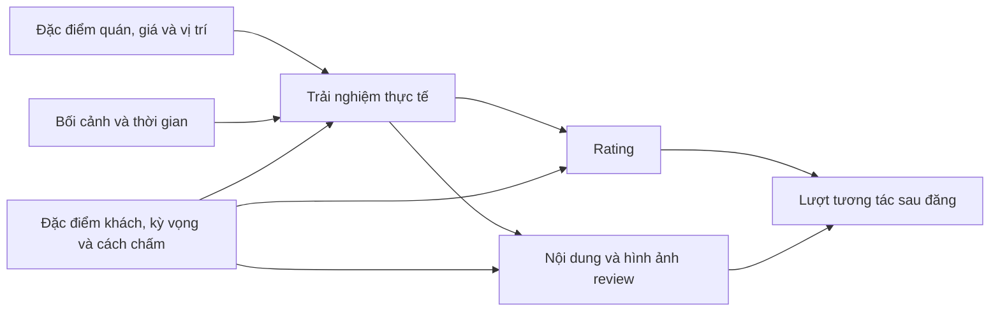

# KẾ HOẠCH EDA ĐA YẾU TỐ — CÁC YẾU TỐ NÀO TÁC ĐỘNG LÊN RATING?

**Dự án:** Food Review Sentiment Analysis — ADY201m.  
**Giai đoạn:** tuần 5–6, phục vụ Report 3.  
**Ngày lập:** 19/10/2026.  
**Workspace:** `E:\Real-estate-tourism\hung`.  
**Định hướng do người thực hiện dự án xác nhận:** “Các yếu tố nào tác động lên rating?”

## 1. Mục tiêu và phạm vi đúng của nghiên cứu

Mục tiêu là khảo sát **những nhóm yếu tố gắn với sự khác biệt của rating**, xác định chiều liên hệ, độ lớn, mức độ chắc chắn và mức đóng góp khi xem xét đồng thời nhiều yếu tố. Các nhóm chính gồm đặc điểm quán, địa lý, giá/chi tiêu, trải nghiệm dịch vụ, người đánh giá, bối cảnh sử dụng, thời gian và mức độ phổ biến. Nội dung review, ảnh và tương tác được dùng như các lớp thông tin bổ sung, với vai trò được giải thích rõ.

**Biến kết quả chính là giá trị rating đầy đủ của từng review**, chưa chuyển bài toán chính thành phân loại “1 sao/điểm thấp”. Sentiment và từ khóa giúp hiểu trải nghiệm mà khách mô tả, là một nhánh trong nghiên cứu đa yếu tố.

Từ “tác động” được giữ trong câu hỏi tổng quát của dự án. Với dữ liệu quan sát đang có, báo cáo tuần 5–6 trước hết ước lượng **mối liên hệ và mối liên hệ sau điều chỉnh**. Muốn kết luận can thiệp vào một yếu tố sẽ làm rating thay đổi bao nhiêu, cần thêm giả định và thiết kế nhân quả phù hợp. Cách phân biệt này giúp trả lời đúng mức bằng chứng, không thu hẹp các nhóm yếu tố cần nghiên cứu. Xem nền tảng phương pháp trong [Hernán & Robins — Causal Inference: What If](https://miguelhernan.org/whatifbook).

**Đầu ra môn học:** EDA bằng RStudio, notebook/script cleaning đã làm và Data Dictionary, tổng hợp thành Report 3. Kế hoạch giữ phần cleaning hiện có làm đầu vào; bổ sung audit và chuẩn bị bảng phân tích khi cần. Report 4 và hai mô hình ML thuộc tuần 7–8, chỉ được thiết kế bàn giao ở cuối kế hoạch này.

Đây là **một kế hoạch mới** thay cho định hướng EDA quá tập trung vào text/điểm thấp của file trước. Các tài liệu cũ được dùng làm bối cảnh và yêu cầu môn; câu hỏi nghiên cứu mà bạn vừa xác nhận là định hướng ưu tiên. Những công việc kiểm tra, trích xuất hoặc bổ sung dữ liệu dưới đây là việc cần thực hiện theo kế hoạch, chưa phải kết quả đã chạy xong.

## 2. Câu hỏi nghiên cứu và thước đo cần trả lời

### 2.1. Câu hỏi chính

> Đặc điểm nào của quán, vị trí, giá/chi tiêu, trải nghiệm, người đánh giá, bối cảnh và thời gian có liên hệ với rating; các liên hệ đó còn tồn tại và có độ lớn ra sao khi xét đồng thời các yếu tố khác?

Một kết quả đủ tốt cần trả lời được năm ý:

1. **Yếu tố gì?** Định nghĩa và cách đo cụ thể, không chỉ tên khái niệm.
2. **Liên hệ theo chiều nào?** Cao hơn, thấp hơn, phi tuyến hay khác nhau giữa các nhóm.
3. **Khác biệt bao nhiêu điểm rating?** Báo độ lớn trên thang gốc và khoảng tin cậy khi có.
4. **Có còn sau điều chỉnh không?** Phân biệt quan hệ thô với quan hệ khi đã xét các biến nền phù hợp.
5. **Kết luận áp dụng ở đâu?** Nêu phạm vi nguồn, thời gian, nhóm quán, độ phủ và các yếu tố chưa đo được.

### 2.2. Các câu hỏi con

| Mã | Câu hỏi | Nhóm yếu tố | Đơn vị chính |
|---|---|---|---|
| RQ-A | Rating khác nhau thế nào theo loại quán, loại ẩm thực, phân khúc giá, thương hiệu hoặc tiện ích đã xác minh? | Đặc điểm quán | Review, có nhóm theo quán |
| RQ-B | Vị trí địa lý có liên hệ với rating không, sau khi xét khác biệt cơ cấu quán và khách đánh giá? | City, khu vực, vị trí | Review/quán |
| RQ-C | Mức chi tiêu và cảm nhận “đáng tiền” liên hệ thế nào với rating? | Giá, chi tiêu, giá trị cảm nhận | Review/lần trải nghiệm |
| RQ-D | Chất lượng món, phục vụ, không gian, vệ sinh, tốc độ và giao hàng được khách mô tả thế nào ở các mức rating? | Trải nghiệm và dịch vụ | Review |
| RQ-E | Rating có khác theo đặc điểm và lịch sử đánh giá của người viết không? | Người đánh giá | Review, có nhóm theo người viết |
| RQ-F | Thời điểm, quy mô nhóm khách, kênh dùng dịch vụ và bối cảnh trải nghiệm có liên hệ với rating không? | Thời gian/bối cảnh | Review |
| RQ-G | Mức độ phổ biến hoặc uy tín đã có trước đó của quán liên hệ thế nào với rating mới? | Lịch sử quán | Review theo thời gian |
| RQ-H | Nhóm yếu tố nào giải thích hoặc dự báo thêm được rating khi bổ sung vào các nhóm đã có? | Tổng hợp đa biến | Cùng tập review và thiết kế đánh giá |

RQ-A đến RQ-G là các nhánh của một câu hỏi chung. Tuần 5 phải chốt những nhánh **đo được bằng dữ liệu**, những nhánh cần bổ sung và những nhánh chưa đủ bằng chứng; không tự bỏ một nhóm chỉ vì file CSV hiện tại chưa xuất cột đó.

### 2.3. Giả thuyết để tổ chức phân tích

Không cần giả định trước rằng giá cao, quán nổi tiếng hay người viết lâu năm chắc chắn làm rating tăng/giảm. Dùng giả thuyết theo nhóm, thí dụ:

- **H0-A:** sau khi xét các biến nền đã chọn, nhóm đặc điểm quán không có liên hệ với rating; **H1-A:** có ít nhất một liên hệ trong nhóm.
- **H0-C:** không có liên hệ giữa mức chi tiêu đã xác minh và rating sau điều chỉnh; **H1-C:** có liên hệ, có thể phi tuyến.
- **H0-E:** khác biệt giữa người đánh giá không đóng góp đáng kể vào biến thiên rating trong phạm vi dữ liệu; **H1-E:** có khác biệt đáng kể cần tính đến.
- **H0-H:** bổ sung nhóm yếu tố mới không cải thiện dự báo rating trên dữ liệu giữ riêng; **H1-H:** có cải thiện với độ lớn được báo cáo.

Danh sách giả thuyết xác nhận được chốt sau kiểm tra ý nghĩa/độ phủ biến và trước xem kết quả liên hệ chi tiết. Những phân tích khác ghi rõ là thăm dò. Không tạo một giả thuyết xác nhận cho mọi cột rồi chọn kết quả có p-value thấp.

## 3. Định nghĩa rating và cấu trúc dữ liệu

### 3.1. Rating nào là biến kết quả?

| Mức | Biến | Vai trò | Lưu ý |
|---|---|---|---|
| Review — chính | `rating_review`, từ `reviews.rating`/raw `AvgRating` | Giải thích sự khác biệt điểm mà từng khách chấm | Giữ số thập phân và thang nguồn; không tự gọi điểm Foody là sao |
| Quán — bổ sung | `mean_rating_crawled_valid` | Trung bình rating hợp lệ trong mẫu review đã crawl | Chỉ đại diện mẫu crawl; báo số review và phân phối kèm theo |
| Quán/platform — có điều kiện | `platform_avg_rating` | Khảo sát mức quán nếu thu thập được | Hiện thiếu trong toàn bộ raw đã audit; không điền bằng trung bình crawl rồi giữ cùng tên |
| Điểm thành phần — có điều kiện | Điểm món ăn/phục vụ/vị trí/giá/không gian nếu nguồn có | Phân rã cách khách chấm hoặc đối chiếu cấu trúc điểm | Cần kiểm tra có phải thành phần tính nên `AvgRating` hay không |

Audit trước đó ghi nhận rating từ 0 đến 10, có mức thập phân; 128 review có rating bằng 0. Trước EDA phải xác minh 0 là điểm hợp lệ hay trạng thái chưa chấm. Giữ cờ riêng đến khi có quyết định. Không tự đổi rating thành nhãn 1 sao hoặc chia 2 để đồng nhất nguồn.

Nếu sau này gộp nhiều nguồn, kiểm tra định nghĩa và cách chấm trước; chuyển thang tuyến tính chỉ thay đơn vị, không chứng minh hành vi chấm điểm tương đương. Phân tích riêng theo nguồn là điểm xuất phát.

### 3.2. Ba mức phụ thuộc cần xử lý

- Nhiều review thuộc cùng một quán.
- Một người có thể đánh giá nhiều quán; một quán có nhiều người đánh giá. Đây có thể là cấu trúc **chéo** giữa quán và người viết.
- Một quán có thể được quan sát nhiều lần theo snapshot; cùng review không được tính lại thành nhiều quan sát độc lập khi mục tiêu là rating review hiện hành.

Vì vậy 265.804 review không đồng nghĩa 265.804 quan sát hoàn toàn độc lập. Cần báo số quán, số người viết và phân phối số review mỗi nhóm; dùng cách ước lượng bất định phù hợp.

## 4. Khung yếu tố và thời điểm đo



Sơ đồ là khung giả định để chọn vai trò biến, chưa phải mô hình nhân quả đã được kiểm định. Cần phân biệt:

| Loại thông tin | Ví dụ | Cách dùng phù hợp |
|---|---|---|
| Đã tồn tại trước trải nghiệm/đánh giá, nếu có lịch sử đúng thời điểm | Vị trí, loại quán, giá trước chuyến đi, danh tiếng trước review | Yếu tố nền, ứng viên phân tích điều chỉnh/dự báo trước rating |
| Gắn với trải nghiệm đang được đánh giá | Chi tiêu thực tế, nhóm khách, thời gian chờ, loại dịch vụ | Yếu tố trải nghiệm; xác minh cách đo và thứ tự thời gian |
| Cùng được khách biểu đạt sau trải nghiệm | Text, ảnh đăng kèm, ý định quay lại, điểm thành phần | Tín hiệu đồng thời để hiểu trải nghiệm, không tự coi là nguyên nhân độc lập |
| Tích lũy sau đăng review hoặc tại lúc crawl | Likes/views/comments, tổng review hồ sơ hiện tại, tổng review quán hiện tại | EDA mô tả/hậu nghiệm; không dùng như đã có trước rating |

**Không dùng lượt thích hiện tại, ý định quay lại hay sentiment của cùng review để kết luận chúng đã gây ra điểm chấm.** Chúng vẫn có thể được khảo sát, nhưng kết quả được đặt đúng nhóm.

## 5. Kiểm kê yếu tố: đã có gì, thiếu gì, cần lấy từ đâu?

### 5.1. Bằng chứng đã có

Audit toàn bộ raw local ngày 19/10/2026 ghi nhận 34.492 restaurant ID và 265.804 review ID duy nhất; 20 review thiếu text. Cả `avg_rating`, `total_reviews`, `category`, `price_range`, latitude và longitude đều thiếu trong 34.492 object sau transform.

Lần kiểm tra bổ sung cho kế hoạch này đọc **24 object ở 8 city slug, tối đa 20 review/object, thực tế 62 review**. Mục đích là nhận diện schema, không ước lượng độ phủ đại diện. Mẫu có `Owner`, `TotalPictures`, `DeviceName`, `TotalLike`, `TotalComment` và một số `Options` chứa `Guest`, `MoneySpend`, `VisitAgain`. Không thấy các cột điểm thành phần trực tiếp trong các review đã kiểm tra; chưa kết luận chúng không tồn tại ở mọi raw hoặc endpoint khác.

Mã ETL có mapping nhiều biến này sang PostgreSQL. Tuy nhiên, **script export EDA hiện tại chưa xuất hết chúng**. Cần mở rộng bảng phân tích trong giai đoạn thực hiện kế hoạch, trước khi kết luận bộ dữ liệu chỉ có text và rating. Chưa kiểm tra lại dịch vụ DB thật ở lần viết kế hoạch này.

### 5.2. Ma trận khả dụng và vai trò

Ký hiệu ưu tiên: **P0** = cần cho câu hỏi chính; **P1** = làm khi dữ liệu đủ, có giá trị rõ; **P2** = mở rộng sau, không chặn Report 3. “Có mapping” là trạng thái code, chưa phải xác nhận độ đầy đủ toàn DB.

| Nhóm | Biến ứng viên | Nguồn/đường lấy | Trạng thái bằng chứng | Ưu tiên và hành động |
|---|---|---|---|---|
| Địa lý | City, country scope | Raw restaurant, `restaurants.city` | Có cấu trúc và inventory city; có địa điểm ngoài Việt Nam | P0: chuẩn hóa mapping và kiểm tra coverage |
| Địa lý chi tiết | District, vị trí trung tâm/xa trung tâm | Địa chỉ; metadata nguồn; tọa độ nếu bổ sung | District chưa có cột chuẩn; tọa độ thiếu toàn bộ raw audit | P1: parse có kiểm tra; không suy đoán từ tên quán |
| Loại quán/ẩm thực | Category, cuisines, loại dịch vụ | Trang chi tiết/listing/raw bổ sung, bảng cuisines | Category thiếu toàn bộ; cuisines chưa audit đầy đủ | P0 cho khảo sát đa yếu tố: audit và pilot bổ sung |
| Phân khúc giá | Khoảng giá/quán, đơn vị tiền, giá trên người nếu nguồn nói rõ | Metadata quán, `price_range` | Thiếu toàn bộ raw audit | P0: xác định nguồn, phạm vi và timestamp |
| Thương hiệu/tiện ích | Chuỗi/độc lập, chỗ đỗ xe, điều hòa, đặt bàn… | Metadata công khai xác minh được | Chưa có bằng chứng đã thu thập | P1/P2: chỉ chọn một số biến đo được, không suy từ tên |
| Chi tiêu thực tế | `money_spend` | `Options.MoneySpend` → `reviews.money_spend` | Có trong một phần mẫu, có mapping | P0: audit mức độ có dữ liệu và nghĩa đơn vị |
| Quy mô nhóm khách | `guest_count` | `Options.Guest` → `reviews.guest_count` | Có trong một phần mẫu, có mapping | P1: kiểm tra dạng số/khoảng/nhãn |
| Trải nghiệm trực tiếp | Món ăn, phục vụ, không gian, vệ sinh, tốc độ, giao hàng | Điểm thành phần nếu có; text mã hóa chủ đề/cảm nhận | Chưa xác nhận điểm thành phần; text có | P0: đo đa khía cạnh với quy trình riêng, mục 8 |
| Người viết | ID giả danh, số review/ảnh, verified, trust, verifying | Raw `Owner` và bảng `reviewers` | Có schema/mapping và mẫu; chưa audit toàn bộ độ phủ/ý nghĩa | P0: trích thêm, phân biệt hồ sơ lúc crawl với lịch sử trước review |
| Lịch sử người viết | Số review đã đăng trước đó; xu hướng chấm cao/thấp trước đó | Dữ liệu review theo thời gian đã quan sát | Có thể dẫn xuất một phần, không phải toàn lịch sử platform | P1: chỉ dùng quá khứ, ghi rõ coverage |
| Thời gian | Năm/tháng/ngày trong tuần đăng review | `review_date` | Audit trước không thiếu ngày sau parse | P0: đây là ngày đăng, không tự gọi ngày ăn |
| Ngày trải nghiệm | Travel/visit date, khung giờ dùng dịch vụ | Nguồn cung cấp nếu có | Có một số cột/schema nhưng chưa xác nhận dữ liệu | P1: audit; không thay bằng crawl time |
| Mức phổ biến quán | Tổng review platform, số review đã có trước đó | Metadata lịch sử; count quá khứ trong mẫu crawl | Tổng platform thiếu; count trong mẫu có thể tính | P0 cho khảo sát, dùng tên và thời điểm đúng |
| Uy tín trước review | Trung bình rating từ các review trước đó | Tập quá khứ theo quán | Dẫn xuất được khi có lịch sử đủ và thứ tự ngày rõ | P1: không bao gồm review mục tiêu hoặc dữ liệu tương lai |
| Ý định quay lại | `visit_again` | `Options.VisitAgain` | Có trong một phần mẫu, có mapping | P1: biến phản ứng đồng thời, mô tả riêng |
| Hình thức review | Ảnh, độ dài, title, thiết bị, loại bài | Review raw/DB; `DeviceType`, `TypeName` nếu xác minh | Nhiều field có trong mẫu, một phần chưa xuất CSV | P1: không diễn giải thiết bị là thuộc tính giàu/nghèo |
| Tương tác | Likes, views, comments | Review raw/DB | Có field/mapping, tích lũy đến lúc crawl | P1: hậu nghiệm; cần xét tuổi bài khi mô tả |
| Kỹ thuật lấy mẫu | Source, crawl time, completeness, raw hash | Raw/ledger/manifest | Có cơ chế lưu và metadata | P0: kiểm soát phạm vi/bias, không gọi là chất lượng dịch vụ |

Không thu thập hoặc suy đoán tuổi, giới, thu nhập, sắc tộc của người viết từ tên, ảnh hay thiết bị. “Kinh nghiệm viết review” và “độ tin cậy hồ sơ” cũng không tự động đo độ đúng của điểm chấm.

### 5.3. Bổ sung dữ liệu theo mức độ cần thiết

**Bước 1 — khai thác phần đã có:** lập coverage cho các cột review/reviewer/options trong toàn snapshot; đọc raw những field có nhưng chưa ETL; mở rộng export. Đây là ưu tiên trước khi mở rộng crawler.

**Bước 2 — pilot metadata quán:** chọn khoảng 40–60 quán theo city và quy mô review, lấy mẫu không dựa riêng vào điểm cao/thấp. Kiểm tra khả năng lấy loại quán, ẩm thực, giá và bối cảnh dịch vụ từ nguồn công khai tương ứng. Ghi chính xác trường nguồn, đơn vị, timestamp và tỷ lệ lấy được. Cỡ pilot là đề xuất quản lý công việc, không bảo đảm đủ kiểm định.

**Bước 3 — quyết định trong tuần 5:** nếu pilot đáng tin, mở rộng cho phạm vi quán đã định; nếu không, giữ nhóm đó ở trạng thái “chưa đo được” và trình bày lý do. Phạm vi rộng hơn cần thêm thời gian phải là hạng mục riêng, không âm thầm chuyển toàn bộ tuần 5–6 thành viết crawler.

**Bước 4 — bảo vệ thời gian:** metadata crawl tháng 10/2026 không được tự coi là giá/loại hình năm mà review cũ được đăng. Ghi `metadata_observed_at`; ưu tiên ghép snapshot gần nhất **không sau** ngày review nếu có lịch sử. Chỉ có metadata hiện tại thì phân tích như đặc điểm quán quan sát hiện tại, nêu giới hạn khi liên hệ review quá khứ; không dùng nó để giả lập dự báo lịch sử không rò rỉ.

Một nhóm yếu tố thiếu dữ liệu phải có dòng trong bảng kết quả cuối với trạng thái “chưa đủ dữ liệu”. Thiếu dữ liệu không phải bằng chứng “không tác động”.

## 6. Chuẩn bị bộ dữ liệu đa yếu tố

### 6.1. Các bảng cần tạo

| Bảng | Một dòng đại diện | Cột chính | Mục đích |
|---|---|---|---|
| `analysis_reviews_multifactor` | Một review ở snapshot được chọn | Rating, quán, reviewer giả danh, địa lý, thời gian, chi tiêu, nhóm khách, ảnh, nguồn và lineage | Bảng chính cho EDA đa biến |
| `analysis_restaurants` | Một quán/nguồn trong snapshot | Category, cuisines, price, metadata timestamp, số review mẫu, rating mẫu và biến platform có tên riêng | Đối chiếu ở cấp quán, kiểm tra cơ cấu |
| `analysis_reviewer_history` | Một reviewer/nguồn tại mốc thời gian hoặc các biến quá khứ của từng review | Số bài trước đó, mức chấm trước đó, coverage lịch sử; hồ sơ lúc crawl để riêng | Kiểm soát khác biệt người viết |
| `analysis_experience_aspects` | Một review với các khía cạnh đã mã hóa | Mention/polarity món ăn, phục vụ, giá trị, không gian, vệ sinh, giao hàng; phương pháp và độ tin cậy | Nhánh trải nghiệm, bổ sung vào bảng chính không nhân dòng |
| `factor_coverage` | Một biến hoặc nhóm yếu tố trên một tập | Nonmissing, valid, số review, số quán, thời điểm đo, nguồn | Quyết định biến được dùng và giới hạn |

### 6.2. Quy tắc nối và tên cột

- Khóa quán: `(source_code, source_restaurant_id)`; khóa review: `(source_code, source_review_id)`; khóa reviewer: `(source_code, reviewer_id)`.
- Join reviewer bằng cả source và reviewer ID, không join chỉ theo tên. Dùng `LEFT JOIN` khi không có hồ sơ để giữ review cho những phân tích không cần reviewer.
- Aggregate cuisines/tags trước join; dữ liệu aspect nhiều khía cạnh cần pivot về một dòng/review trước khi gộp vào bảng chính.
- Sau mỗi join, kiểm tra số dòng, uniqueness review và tỷ lệ match. Không loại mọi review không đủ metadata bằng một lệnh `inner join` mà không báo mất mẫu.
- Đặt tiền tố rõ: `restaurant_*`, `reviewer_*`, `review_*`, `prior_*`, `platform_*`, `crawl_*`. Hai biến tên `total_reviews` của quán và của người viết không được nhập nhằng.
- `reviewer_id` dùng cho grouping/kiểm tra phụ thuộc, không làm feature số; xuất ID giả danh hoặc mã nhóm, không xuất tên/URL cá nhân vào báo cáo.

### 6.3. Các tập phân tích khác nhau

| Tập | Điều kiện | Vai trò |
|---|---|---|
| `D_rating` | Trong scope, rating hợp lệ | Phân bố rating và câu hỏi không cần text |
| `D_structure` | Rating hợp lệ, đủ các biến nền của mô hình cấu trúc đã chốt | Địa lý, thời gian, quán/người viết/bối cảnh |
| `D_price` | Đủ chi tiêu hoặc metadata giá đúng định nghĩa | Phân tích giá; có thể nhỏ hơn D_rating |
| `D_text` | Rating hợp lệ và text đủ nội dung | Khía cạnh trải nghiệm/sentiment |
| `D_overlap` | Giao tập cần thiết cho phép so sánh nhóm yếu tố | So sánh đóng góp công bằng trên cùng review |

**Không bắt buộc review có text để vào D_rating/D_structure.** Nếu so mô hình có text với mô hình cấu trúc, fit cả hai trên cùng `D_overlap` và cùng split; không lấy kết quả từ hai cohort khác nhau làm bằng chứng text cải thiện.

Thiếu biến được xử lý theo mục đích: giữ unknown có giải thích cho biến phân loại, dùng complete case có báo selection hoặc imputation có giả định rõ. Không điền một hằng số “đẹp” để tạo loại quán/giá không tồn tại. Nếu imputation phục vụ dự báo thì chỉ fit trong train của từng fold.

### 6.4. Đóng băng và version

Dùng cơ chế snapshot/manifest đã bổ sung; tạo **dataset ID mới cho bảng đa yếu tố**, lưu hash dữ liệu, phiên bản mapping địa lý/giá, quy tắc biến dẫn xuất, timestamp metadata và mã xử lý. Không coi file export cũ thiếu cột là đầu vào cuối cùng. Giữ bảng coverage và funnel trước–sau join/lọc cùng dataset; một row có thể vi phạm nhiều cờ nên funnel loại tuần tự phải tránh đếm chồng.

## 7. Danh mục EDA theo từng nhóm yếu tố

Tất cả biểu đồ thể hiện rating phải ghi rõ nguồn, thang, subset, số review và số quán; thêm số reviewer khi câu hỏi liên quan người viết. Số nhóm/cỡ mẫu gợi ý dưới đây là tiêu chí trình bày thực dụng, không phải bảo đảm thống kê. Không có dữ liệu cho một mục thì ghi kết quả feasibility và bước bổ sung thay vì tạo số liệu minh họa như kết quả thật.

### E00 — Phân bố rating, cơ cấu và coverage

**Mục tiêu:** biết nền dữ liệu và phần nào của câu hỏi đo được.

1. Vẽ phân bố rating đủ thang, giữ thập phân; báo tách 0/NULL/chưa hợp lệ.
2. Đếm review, quán, reviewer, thời gian; số quán/reviewer chỉ có một review.
3. Vẽ ma trận độ phủ các nhóm yếu tố, tỷ lệ missing theo city, thời gian và mức rating.
4. Tạo funnel raw → join → scope → rating hợp lệ → từng cohort; không lấy D_text làm đại diện mọi review.
5. Báo mức tập trung review do top quán/người viết đóng góp; kiểm tra khác biệt giữa trọng số review và mỗi quán cùng trọng số.

**Đầu ra:** bảng cơ cấu, bảng coverage và 2–3 hình chẩn đoán. Đây là cơ sở chốt ưu tiên, không phải kết luận về tác động.

### E01 — Địa lý và vị trí

**X:** city, vùng phân tích, district nếu xác minh; khoảng cách/vị trí chỉ khi có tọa độ và mốc tham chiếu hợp lệ.

- Vẽ phân bố rating theo city với n review/n quán; hình chấm trung bình/median và khoảng bất định thích hợp.
- So sánh kết quả tính theo review với tóm tắt mỗi quán; một city có nhiều review của vài quán không được chi phối cách kể kết quả.
- Tiếp theo so city trong cùng loại quán/phân khúc giá nếu có overlap; giữ country scope riêng. Dữ liệu có địa điểm ngoài Việt Nam, không tự gán vào Bắc/Trung/Nam.
- Nếu dùng khoảng cách trung tâm, phải chốt trung tâm của từng địa phương và cách đo; không lấy latitude hay số thứ tự city làm thước đo tốt/xấu.

**Trả lời:** khác biệt rating theo vị trí lớn bao nhiêu; có giảm khi xét cơ cấu quán/giá/người viết không? Không diễn giải cư dân vùng nào “khó tính hơn” chỉ từ mean city.

### E02 — Loại quán, ẩm thực và đặc điểm kinh doanh

**X:** category, cuisines, mô hình dịch vụ, chuỗi/độc lập hoặc tiện ích nếu có nguồn xác minh.

- Chuẩn hóa category/cuisine theo từ điển có version; quán nhiều cuisine được xử lý như nhiều nhãn hoặc nhóm chính có quy tắc, không tự nhân số review.
- Vẽ phân bố và bảng rating theo nhóm, kèm số quán; tách nhóm hiếm vào phụ lục hoặc nhóm khác theo quy tắc trước xem Y.
- So sánh trong cùng city/price khi dữ liệu cho phép, để giảm việc nhầm đặc điểm địa lý/giá với loại quán.
- Với thương hiệu, cần mapping xác thực; tên có từ giống nhau chưa đủ xác định cùng chuỗi.

**Trả lời:** loại quán/ẩm thực nào liên hệ với mức rating khác, và khác biệt có còn khi kiểm soát bối cảnh không? Nếu chưa bổ sung được metadata, mục này kết thúc bằng bảng thiếu dữ liệu và độ phủ cần đạt, không kết luận bằng proxy tên quán.

### E03 — Giá, chi tiêu và “đáng tiền”

Phân biệt ba đại lượng: **giá quán công bố**, **khách khai đã chi**, và **cảm nhận giá trị/đáng tiền trong lời nhận xét**. Không gộp thành một biến “giá”.

- Audit định dạng `MoneySpend` và `price_range`: số, khoảng, nhãn, currency, trên người hay trên nhóm. Giá không rõ đơn vị giữ unknown.
- Với khoảng chi tiêu, ưu tiên biến thứ bậc/range; chỉ dùng midpoint cho khoảng hữu hạn khi có lý do và kiểm tra độ nhạy. Không gán midpoint tùy tiện cho khoảng mở.
- Vẽ rating theo phân khúc/chi tiêu, scatter hoặc smooth nếu số liên tục có nghĩa; xem khả năng phi tuyến, không chỉ một hệ số tương quan.
- So sánh trong city/category tương đồng. Nếu muốn tính chi tiêu/người, phải xác minh cả Guest và MoneySpend có đơn vị tương thích.
- Tách mức đắt tuyệt đối khỏi nhận xét “không đáng tiền”; đánh giá sự khác biệt giữa kỳ vọng và giá trị cảm nhận.

**Trả lời:** rating liên hệ với mức giá nào, ở nhóm nào và khác biệt bao nhiêu điểm? Chi tiêu cao có thể phản ánh trải nghiệm/đối tượng khách khác; giá hiện tại không tự là giá tại thời điểm review cũ.

### E04 — Món ăn, phục vụ, không gian và các khía cạnh trải nghiệm

**Khía cạnh tối thiểu đề xuất:** chất lượng/hương vị món; phục vụ/thái độ; giá trị so với tiền; không gian; vệ sinh; tốc độ/chờ đợi. Thêm giao hàng, đóng gói và nhiệt độ món khi có đủ review thuộc ngữ cảnh đó.

- Nếu có điểm thành phần trực tiếp, xác minh thang, missing và công thức liên hệ với `AvgRating`, thực hiện mục 8.1 trước.
- Nếu dùng text, mã hóa **khía cạnh được nhắc** và **cảm nhận tích cực/tiêu cực/hỗn hợp** riêng. Không nhắc đến vệ sinh không đồng nghĩa vệ sinh tốt.
- So sánh phân bố rating giữa các trạng thái trong từng khía cạnh; kiểm tra chung với giá, city, loại quán và độ dài review để hiểu khác biệt cơ cấu.
- Vẽ heatmap khía cạnh × cảm nhận × rating tóm tắt, kèm n/quán; chọn trích đoạn đã ẩn định danh và giữ ngữ cảnh phủ định.

**Trả lời:** các trải nghiệm nào được mô tả cùng rating cao/thấp, trong phạm vi review có text. Không gọi đặc trưng sentiment của chính câu chữ là đo lường khách quan chất lượng thật của quán.

### E05 — Đặc điểm và xu hướng chấm của người đánh giá

**X:** mức hoạt động, verified/trust nếu định nghĩa rõ, lịch sử chấm trong tập đã quan sát và khác biệt giữa người viết.

- Thống kê số review mỗi reviewer, số quán từng reviewer đánh giá; kiểm tra mức độ lặp để chọn mô hình phụ thuộc.
- Phân biệt profile `Owner.TotalReviews` tại lúc crawl với `prior_observed_reviews` trước từng review. Cả hai không phải cùng biến “kinh nghiệm khi chấm”.
- So sánh rating theo nhóm hoạt động và verified, cùng city/category khi đủ; kiểm tra thiếu hồ sơ có gắn với thời gian/nguồn không.
- Tạo mean/median mức chấm trước đó chỉ từ review có thời điểm trước review mục tiêu. Người chưa có quá khứ quan sát cần cờ cold start; không tự gán là người mới trên platform.
- Nếu chỉ EDA phong cách chấm trên cả sample, có thể báo summary mỗi reviewer với n tối thiểu đề xuất; không tái sử dụng summary chứa rating mục tiêu làm feature dự báo chính rating đó.

**Trả lời:** mức khác biệt giữa người chấm lớn tới đâu; liên hệ của quán/giá có thay đổi khi tính đến người viết không? Không suy ra người nhiều bài khách quan hơn hoặc reviewer mới dễ tính hơn trước khi phân tích.

### E06 — Bối cảnh sử dụng dịch vụ

**X:** Guest, chi tiêu, loại phục vụ/dine-in/delivery nếu xác minh; mục đích bữa ăn chỉ khi nguồn hoặc text được mã hóa có quy trình.

- Kiểm tra quy mô nhóm khách dưới dạng số/khoảng/nhãn; không mặc định mọi trường là numeric.
- So rating theo nhóm khách và kênh dịch vụ, trước và sau phân tầng giá/category nếu đủ dữ liệu.
- Nếu nhóm lớn thường chi nhiều hơn, tách tổng chi và chi/người đúng đơn vị; không diễn giải tương quan tổng chi là hiệu ứng giá cá nhân.
- Không lấy `DeviceName`, `TypeName` hoặc việc nhắc “giao” trong một câu làm bằng chứng chắc chắn khách đặt giao hàng nếu chưa kiểm tra quy tắc nhận diện.

**Trả lời:** bối cảnh nào đi cùng rating khác và liệu khác biệt có do mức chi/loại quán hay không? Các trường options thiếu nhiều có thể tạo một tập khách tự chọn, phải so sánh cơ cấu cohort đó với toàn mẫu.

### E07 — Thời gian và biến động

**X:** năm, tháng, ngày trong tuần đăng review; ngày trải nghiệm thật nếu có.

- Chuyển timestamp có căn cứ; phân biệt review date, ngày trải nghiệm, ngày crawl và ngày load.
- Vẽ rating và quy mô dữ liệu theo thời gian; trình bày số quán/người viết đóng góp tại mỗi mốc.
- So cùng quán qua thời gian khi đủ review để giảm nhầm biến động thành phần quán với thay đổi mức chấm; cân nhắc các khoảng thời gian có đủ overlap.
- Nếu chỉ có ngày đăng, thứ trong tuần là **thứ đăng review**, không phải thứ khách ăn. Chỉ khảo sát giờ ăn/mùa/lễ khi có thời gian trải nghiệm và mapping phù hợp.
- Chưa gắn weather, sự kiện hay thay đổi quản lý từ dữ liệu ngoài trong phạm vi mặc định; chỉ thêm khi có câu hỏi cụ thể, timestamp phù hợp và thời gian cho phép.

**Trả lời:** khác biệt rating theo thời gian còn tồn tại trong nhóm quán tương đồng không? Dữ liệu hồi cứu có thể thiếu bài bị xóa và chịu lịch crawl, cần giữ giới hạn đó trong kết luận.

### E08 — Mức phổ biến và danh tiếng trước đó của quán

**X:** số review có trước thời điểm đánh giá, rating quá khứ, tốc độ xuất hiện review mới nếu quan sát đủ; metadata platform lịch sử nếu bổ sung.

- Tính `prior_observed_review_count` và `prior_observed_mean_rating` bằng dữ liệu trước từng review; ngày bằng nhau cần quy tắc, nếu chỉ có ngày thì tránh suy thứ tự trong ngày.
- Vẽ rating mới theo quy mô/quá khứ, theo city/category; dùng `log1p` cho count nếu lệch mạnh.
- Không lấy tổng review đã crawl đến hiện tại để giả làm mức phổ biến tại ngày một review từ nhiều năm trước.
- Không đưa mean quán chứa review mục tiêu hoặc các review tương lai vào X. Leave-one-out trên toàn tương lai chỉ loại được tự chứa Y, chưa giải quyết rò rỉ thời gian.
- Ở cấp quán, quan hệ giữa count mẫu và mean mẫu vẫn có thể mô tả riêng, nêu rõ nó không là “đông khách làm chất lượng giảm”.

**Trả lời:** danh tiếng/mức hoạt động quan sát trước đó đi cùng rating mới như thế nào? Count trong sample là lịch sử quan sát được, có thể là cận dưới của hoạt động platform.

### E09 — Ảnh, độ dài và hình thức biểu đạt

**X:** có ảnh/số ảnh đăng kèm, độ dài, title, thiết bị hoặc loại bài đã xác minh.

- So rating theo có/không ảnh và số ảnh, text length; kiểm tra age bài, city và kiểu review.
- Phân biệt ảnh đính kèm bài với tổng ảnh của profile, và ảnh có tại lúc crawl với lịch sử nếu có thay đổi bài.
- Với text length, báo ký tự hoặc token tách khoảng trắng đúng tên; không gọi số token khoảng trắng là số từ tiếng Việt đã tách từ.
- Xem đây là dấu hiệu hành vi biểu đạt/chọn mẫu. Không suy “đính ảnh làm khách hài lòng hơn” hay thiết bị đắt làm điểm cao.

**Trả lời:** hình thức đăng bài có gắn với cách chấm không, có giúp nhận diện bias của tập review có text/ảnh không? Nhánh này hỗ trợ giải thích cách ghi nhận đánh giá.

### E10 — Ý định quay lại và tương tác sau đăng

**Biến:** `visit_again`, likes, comments, views; tuổi review tại crawl và thời điểm quan sát.

- Lập bảng rating × ý định quay lại để đánh giá tính nhất quán giữa các biểu hiện hài lòng.
- Vẽ tương tác theo rating có xét tuổi bài; bài lâu năm có nhiều thời gian tích lũy tương tác hơn.
- Không đưa các biến này vào mô hình tìm liên hệ trước trải nghiệm như covariate mặc định; chúng có thể nằm sau rating/trải nghiệm và tạo diễn giải sai.
- Tránh suy tương tác là nguyên nhân điểm chấm, và không xem lượt thích như độ đúng của review.

**Trả lời:** các phản ứng đi kèm có nhất quán với điểm số và gợi ý selection/visibility bias gì? Kết quả đặt ở phần bổ sung, tách khỏi các yếu tố nền.

## 8. Đo trải nghiệm và kiểm tra điểm thành phần

### 8.1. Nếu nguồn có điểm thành phần

1. Xác minh tên gốc, ý nghĩa, thang điểm, giá trị 0 và mức độ đầy đủ từng chiều; không tạo các cột này chỉ từ suy đoán về Foody.
2. Kiểm tra trên nhiều review liệu `AvgRating` có được tính từ các điểm thành phần bằng trung bình hoặc công thức khác không; cần đối chiếu tài liệu/giao diện nguồn nếu có, không khẳng định trọng số từ vài ví dụ.
3. Nếu Y được tính trực tiếp từ các điểm đó, báo cáo **cấu trúc/phân rã rating**: các chiều khách chấm ra sao, chiều nào thấp, khác biệt giữa các chiều. Không dùng R² cao hay hệ số hồi quy của các thành phần để tuyên bố đã tìm ra nguyên nhân rating.
4. Loại các thành phần cùng tạo nên Y khỏi bộ feature dự báo rating trước khi khách chấm. Chỉ dùng chúng trong một phân tích được đặt tên đúng về cấu tạo thang đo.

### 8.2. Nếu đo khía cạnh từ text

- Xây codebook theo các khía cạnh ở E04; cho phép một review có nhiều khía cạnh và mỗi khía cạnh có sentiment khác nhau.
- Với mỗi khía cạnh, lưu `mentioned`, `polarity` và `uncertain`. Không nhắc ≠ tích cực; từ “giá” không tự có nghĩa giá cao hoặc không đáng tiền.
- Đọc thử khoảng 200–300 review development theo city, mức rating, thời gian và độ dài; hai người gán độc lập một phần mẫu và ghi bất đồng. Đây là cỡ mẫu công việc đề xuất, chưa phải dữ liệu đã gán.
- Khi đánh giá nhãn aspect, ẩn rating nếu có thể để tránh người gán suy nhãn từ Y. Dữ liệu lấy mẫu tăng cường nhóm hiếm cần lưu xác suất/trọng số hoặc chỉ mô tả theo tầng, không lấy tỷ lệ mẫu thô làm tỷ lệ dân số.
- Dictionary/rule hoặc mô hình gán aspect phải đánh giá trên mẫu gán tay; không lấy độ “hợp với rating” làm tiêu chí duy nhất chọn rule. Nêu lỗi phủ định, mỉa mai và nhắc nhiều quán.
- Text được viết sau trải nghiệm nên aspect polarity là cảm nhận khách biểu đạt, không là đo thực nghiệm độc lập về chất lượng quán.

**Đầu ra:** codebook, mẫu gán và thống nhất nhãn, rule/model version, ma trận khía cạnh, độ tin cậy và giới hạn. Không chỉ bàn giao word cloud/top từ.

## 9. Phương pháp thống kê và phân tích đa biến

### 9.1. Đi từ mô tả đến liên hệ đã điều chỉnh

| Bước | Câu hỏi | Phương pháp/đầu ra |
|---|---|---|
| Một biến | Phân phối từng X/Y và missing ra sao? | N, mean/median/IQR/quantile, histogram/ECDF, số quán/reviewer |
| Hai biến | Rating khác nhau theo X như thế nào? | Chênh lệch điểm, đồ thị nhóm/smooth, tương quan phù hợp cho biến số; interval tính đến nhóm |
| Phân tầng | Quan hệ có khác theo city, category hoặc price không? | Small multiples, bảng cơ cấu/overlap; phát hiện nguy cơ Simpson's paradox |
| Đa biến | Liên hệ của X còn ra sao khi xét biến nền? | Mô hình điều chỉnh gọn, hệ số/marginal contrasts và CI |
| Độ bền | Có phụ thuộc quán lớn, missing, thời gian hay rule mã hóa không? | Phân tích sensitivity có lựa chọn được nêu trước |

Không mặc định dùng ANOVA/Kruskal–Wallis trên mọi review rồi coi p-value là hợp lệ khi các review chia sẻ quán/người viết. Với so sánh review, tối thiểu tính phụ thuộc theo quán; nếu người viết lặp xuyên quán đáng kể, xem cấu trúc chéo hoặc phương pháp bất định đa nhóm phù hợp. Bootstrap một chiều theo quán không tự xử lý hết phụ thuộc theo reviewer.

### 9.2. Mô hình liên hệ cho EDA

Một cấu trúc gợi ý, chỉ gồm các biến đã có nghĩa và đủ coverage:

```text
rating_review = đặc điểm quán + địa lý + giá/chi tiêu
              + thời gian + đặc điểm người viết + bối cảnh
              + thành phần khác biệt giữa các quán
              + thành phần khác biệt giữa người viết, khi dữ liệu hỗ trợ
              + phần chưa giải thích
```

- Bắt đầu từ mô hình đơn giản, mở rộng theo block và báo cùng cohort. Không nhét mọi cột có sẵn vào mô hình.
- Với rating thập phân gần thang liên tục, hồi quy tuyến tính/mixed model là lựa chọn thăm dò có thể giải thích theo điểm. Kiểm tra phân phối dư, phương sai không đều, ceiling và dự báo ngoài miền; không mặc định mọi giả định đều đạt.
- Nếu Y thực sự là ít mức thứ bậc của một nguồn khác, cân nhắc ordinal model trong phân tích phù hợp. Không làm tròn điểm Foody để ép thành thang ordinal mới.
- Mixed model với random intercept quán và, khi đủ dữ liệu lặp, reviewer có thể mô tả khác biệt nhóm. Báo số nhóm, n mỗi nhóm, convergence/singular fit; không chọn cấu trúc phức tạp chỉ vì có nhiều dòng. Tài liệu phương pháp: [lme4 — lmer](https://lme4.github.io/lme4/reference/lmer.html).
- **Giới hạn quan trọng:** fixed effects theo quán hấp thụ các biến không đổi trong quán như city/loại quán tại một snapshot. Không dùng mô hình đó để tuyên bố đã ước lượng riêng hiệu ứng city/price cố định. Random effects cũng có giả định về quan hệ với covariate; cần diễn giải như liên hệ và kiểm tra within/between phù hợp khi cần.
- Không đưa cùng lúc country, region và toàn bộ city như các bộ phân loại độc lập nếu chúng xác định lẫn nhau. Kiểm tra biến tương quan mạnh và reference category.

### 9.3. Điều chỉnh theo câu hỏi, không theo danh sách cột

Ví dụ khi hỏi quan hệ **giá → rating**, loại quán/city/cơ cấu khách có thể là biến nền cần cân nhắc; “đáng tiền”, sentiment sau trải nghiệm hoặc ý định quay lại có thể nằm trên đường trải nghiệm/đáp ứng. Điều chỉnh tất cả các biến đó có thể thay đổi chính đại lượng đang hỏi. Ghi một sơ đồ/giải thích lựa chọn covariate cho từng câu hỏi chính.

Không dùng likes/comments/mean quán có chứa Y để làm biến kiểm soát mặc định. Những yếu tố chưa đo như kỳ vọng cá nhân, khẩu vị hoặc mục đích chuyến đi cần được thừa nhận, không giả định đã loại hết confounding chỉ nhờ có mô hình đa biến.

### 9.4. Báo độ lớn, bất định và nhiều phép so sánh

- Ưu tiên chênh lệch trên thang điểm rating gốc: so hai nhóm, thay đổi theo một khoảng chi tiêu có ý nghĩa hoặc đường quan hệ phi tuyến. Báo cả tỷ trọng/mức hỗ trợ, không chỉ dấu của hệ số.
- Với nhiều mức categorical, có kiểm tra/đánh giá tổng thể theo nhóm rồi mới diễn giải contrast được chọn; không chọn city nổi bật sau khi thử hàng trăm cặp mà không báo.
- Chốt một số họ so sánh; nếu có nhiều p-value thăm dò, dùng điều chỉnh như Benjamini–Hochberg theo họ đã định và công khai cách làm. Khi phụ thuộc phép kiểm định đáng kể, nêu giới hạn hoặc cân nhắc phương án bảo thủ phù hợp. Xem [R stats — p.adjust](https://stat.ethz.ch/R-manual/R-devel/library/stats/html/p.adjust.html).
- Một khác biệt có p-value nhỏ nhưng rất ít điểm có thể ít ý nghĩa thực tiễn. Chốt ngưỡng quan tâm theo thang điểm và mục đích trước khi xem kết quả; không bịa một ngưỡng chuẩn của môn học.
- Phần trăm phương sai hoặc độ quan trọng mô hình không tương đương phần trăm tác động nhân quả.

## 10. So sánh đóng góp của các nhóm yếu tố

Tuần 5–6 bàn giao thiết kế này; tuần 7–8 mới chạy đầy đủ các mô hình ML theo môn học.

| Mã | Bộ thông tin | Câu hỏi được trả lời |
|---|---|---|
| B0 | Dự báo hằng số từ train, ví dụ median cho MAE | Có tốt hơn mốc đơn giản không? |
| B1 | Địa lý + thời gian + đặc điểm quán/giá đã có đúng thời điểm | Yếu tố cấu trúc giải thích/dự báo được gì? |
| B2 | B1 + lịch sử người viết và lịch sử quán có trước review | Thông tin quá khứ bổ sung được bao nhiêu? |
| B3 | B2 + bối cảnh trải nghiệm đã xác minh | Bối cảnh bổ sung được gì khi có sẵn tại thời điểm mục tiêu? |
| B4 | B3 + khía cạnh cảm nhận/text/ảnh cùng review | Tín hiệu sau trải nghiệm giải thích thêm rating thế nào? Đây là nhiệm vụ có thông tin khác B1–B3 |

Nếu không đo được một block, ghi “chưa chạy vì thiếu dữ liệu”; không thay nó bằng text rồi vẫn giữ tên. Định nghĩa **thời điểm có thông tin** cho nhiệm vụ dự báo trước rating và nhiệm vụ giải thích sau trải nghiệm. Các block chỉ được so sánh khi dùng cùng cohort, folds và quy tắc xử lý.

Hướng modeling bám câu hỏi mới:

- Giữ Y là rating đầy đủ; metric chính dự kiến **MAE theo điểm rating**, kèm RMSE, R² và phân tích lỗi theo nhóm. Average Precision/F1 chỉ dùng cho một câu hỏi phân loại phụ được định nghĩa riêng. Định nghĩa MAE: [scikit-learn — mean_absolute_error](https://scikit-learn.org/stable/modules/generated/sklearn.metrics.mean_absolute_error.html).
- Hai thuật toán ML có thể là regularized linear regression và một mô hình cây ensemble phù hợp. Mô hình liên hệ trong EDA và mô hình dự báo phục vụ hai mục đích khác nhau, kết quả cần đặt tên đúng.
- Đo đóng góp theo block bằng chênh metric trên validation/CV; dùng độ lớn liên hệ đã điều chỉnh để giải thích kết quả thống kê. Không xếp hạng bằng p-value nhỏ nhất.
- Có thể bổ sung permutation importance trên dữ liệu giữ riêng ở giai đoạn modeling, nhưng cần xem tương quan giữa biến và nhóm yếu tố. Biến tương quan có thể chia sẻ/che lấp importance; không suy importance là nguyên nhân. Xem [scikit-learn — correlated features and permutation importance](https://scikit-learn.org/stable/auto_examples/inspection/plot_permutation_importance_multicollinear.html).

## 11. Chia tập và kiểm soát rò rỉ

1. Trước EDA quan hệ chi tiết, hoàn tất kiểm tra kỹ thuật toàn dữ liệu, định nghĩa Y, scope và semantics của yếu tố. Lưu dataset version.
2. Nếu đánh giá dự báo rating tại **quán chưa thấy**, chia development/test theo quán, tỷ lệ mục tiêu xấp xỉ 80/20. Giữ test riêng; thống kê cấu trúc/độ phủ phục vụ kiểm tra hợp lệ được phép, không khai thác test để chọn feature.
3. Nếu mục tiêu là **rating tương lai ở quán đã biết**, thiết kế split theo thời gian và tính mọi prior feature chỉ từ quá khứ tương ứng. Hai mục tiêu này phải được đặt tên riêng.
4. Review trùng/gần trùng đã xác minh không đi qua hai tập. Không tự coi mọi câu ngắn giống nhau là duplicate cần loại.
5. Reviewer có thể xuất hiện ở nhiều quán: ghi rõ đánh giá new restaurants có cho phép known reviewers hay không. Nếu cần kiểm tra new reviewers, làm thêm thiết kế theo reviewer; không mù quáng gộp mọi quan hệ quán–reviewer thành một nhóm khổng lồ khiến không còn cách chia.
6. Imputation, encode, vocabulary, aspect rule có tinh chỉnh từ dữ liệu và chọn feature chỉ fit/tinh chỉnh trên train/development phù hợp. Profile hiện tại hoặc count toàn bộ sample không được coi là lịch sử tại mỗi fold.
7. Lưu `split_manifest`, seed, định nghĩa task, cohort và kiểm tra giao nhóm. Tham khảo [rsample — group/time splitting](https://rsample.tidymodels.org/reference/initial_split.html).

Trong EDA phục vụ câu hỏi giải thích, phân tích liên hệ chi tiết được thực hiện trên development đã chọn; đây là bằng chứng thăm dò trong mẫu đó. Mọi thay đổi thiết kế sau xem kết quả cần ghi lại, không gọi là giả thuyết đã đăng ký trước.

## 12. Kế hoạch thực hiện 14 ngày

Khối lượng tham khảo khoảng 38–46 giờ làm việc chủ động, chưa tính thời gian chờ nạp dữ liệu. Nếu metadata phải crawl diện rộng và gặp khó khăn, thời gian đó là phần bổ sung cần quản lý riêng. Ưu tiên giữ câu hỏi đa yếu tố và minh bạch nhóm chưa đo được, không dồn hết công việc vào sentiment vì text sẵn hơn.

| Ngày | Công việc chi tiết | Sản phẩm phải có | Điều kiện hoàn thành |
|---|---|---|---|
| T5–N1 | Chốt Y, scope, mục tiêu liên hệ/dự báo; lập sơ đồ yếu tố và danh sách biến; kiểm tra 0 rating; đối chiếu raw–schema–export | `research_questions.md`, `factor_inventory`, định nghĩa Y nháp | Mỗi yếu tố có cách đo/nguồn/thời điểm; câu hỏi chính giữ rating đầy đủ |
| T5–N2 | Audit coverage toàn bộ biến quán, reviewer, options, ảnh, thời gian; xem phần có trong raw nhưng chưa xuất; lập cohort/funnel | `factor_coverage`, gap register, thiết kế bảng phân tích | Phân biệt “không xuất”, “không ETL”, “raw không có”, “chưa xác minh” |
| T5–N3 | Pilot 40–60 quán cho category/cuisine/price; kiểm tra nguồn điểm thành phần; rà lịch sử/timestamp metadata | Báo cáo pilot và quyết định bổ sung có giới hạn | Không kết luận thiếu dữ liệu = không liên hệ; không lấy snapshot hiện tại làm lịch sử giả |
| T5–N4 | Mở rộng extract các biến đã có; join đúng khóa; tạo biến giá/bối cảnh có đơn vị; bắt đầu lấy metadata trong phạm vi khả thi | Dataset đa yếu tố nháp + dictionary v1 | Không nhân review; missing được giữ đúng; trường quán/reviewer đặt tên riêng |
| T5–N5 | Chốt cohort, duplicate policy, dataset và split; tính prior features đúng thời gian; E00 | Dataset v2 + manifest + split + coverage/funnel | Không có tự chứa Y/tương lai trong feature; giữ review thiếu text cho nhánh không cần text |
| T5–N6 | E01–E03: địa lý, loại quán, giá/chi tiêu; so mô tả thô và phân tầng | Biểu đồ/bảng ba nhóm yếu tố, quyết định feasibility còn thiếu | Có n review/n quán, đơn vị giá, overlap và thời điểm metadata |
| T5–N7 | Rà giữa kỳ; sửa câu hỏi đo không được; chốt bộ giả thuyết và phân tích điều chỉnh; commit | Nhật ký quyết định, phân tích ưu tiên tuần 6 | Chưa tự chuyển đề tài thành text classification; mỗi gap có cách xử lý |
| T6–N1 | E05–E06: reviewer và bối cảnh; audit lặp, options và bias của cohort đủ thông tin | Bảng người viết/bối cảnh, các hình và mô tả hạn chế | Hồ sơ lúc crawl tách khỏi lịch sử trước review; có kiểm tra phụ thuộc |
| T6–N2 | E07–E08: thời gian, danh tiếng/mức phổ biến trước đó; so trong cùng quán khi phù hợp | Chuỗi tóm tắt, prior feature audit, hình thời gian | Không dùng count/mean chứa Y hoặc tương lai; không gọi ngày đăng là ngày ăn |
| T6–N3 | E04/E09/E10: aspect trải nghiệm, ảnh/biểu đạt, ý định/tương tác; gán/đối chiếu mẫu text | Codebook/mẫu kiểm tra, bảng khía cạnh và hình hỗ trợ | Không nhắc ≠ tốt; biến hậu nghiệm đặt đúng vai trò; điểm thành phần kiểm tra công thức |
| T6–N4 | Phân tích đa biến gọn; so liên hệ thô/điều chỉnh; kiểm tra cấu trúc nhóm và tương tác có lý do | Bảng hệ số/contrasts + CI, sơ đồ covariate | Chỉ dùng biến đủ nghĩa/coverage; mô hình đạt chẩn đoán hoặc báo rõ chưa đạt |
| T6–N5 | Sensitivity: mỗi quán cùng trọng số, missing/cohort, duplicate, mốc thời gian, coding giá; tổng hợp factor evidence matrix | Bảng kết quả và độ bền theo yếu tố | Có kết quả đủ/chưa đủ bằng chứng/chưa đo được; không chỉ liệt kê p-value |
| T6–N6 | Viết Report 3, hoàn chỉnh dictionary và source R; bàn giao thiết kế regression tuần 7–8 | R Markdown/Quarto render, figures, tables, handoff | Câu hỏi–biến–phương pháp–kết luận khớp; có nhiều nhóm yếu tố ngoài text |
| T6–N7 | Rerun từ session sạch, đối chiếu dataset/hash, review giới hạn và chuẩn bị bảo vệ; commit | Report 3 cuối và bộ tài liệu tái lập | Không dùng test để chọn kết quả; số liệu tái tạo được; ghi AI log và commit theo môn |

Nếu làm một người và cần giảm tải: giảm số tương tác, bớt biến P2 và giới hạn phạm vi metadata được nêu rõ; giữ phân tích nhiều nhóm đo được, cùng bảng các nhóm chưa đo. Không bắt buộc thực hiện mọi nhánh nâng cao để gọi EDA là đầy đủ.

## 13. Danh sách biểu đồ và bảng ưu tiên

### 13.1. Bộ hình chính đề xuất

| Mã hình | Nội dung | Câu hỏi phục vụ | Điều kiện |
|---|---|---|---|
| F01 | Phân bố rating đầy đủ, riêng 0/invalid | Y được đo ra sao? | Bắt buộc |
| F02 | Heatmap coverage theo nhóm yếu tố/city hoặc thời gian | Đo được yếu tố nào, thiếu có chọn lọc không? | Bắt buộc |
| F03 | Rating theo city, kèm n quán và hai cách trọng số | Địa lý | Bắt buộc khi city hợp lệ |
| F04 | Rating theo category/cuisine | Loại quán | Khi bổ sung đủ metadata |
| F05 | Rating theo phân khúc giá hoặc chi tiêu, có phân tầng | Giá và giá trị | Khi đơn vị/coverage được xác minh |
| F06 | Rating theo nhóm reviewer, kèm cấu trúc lặp | Người đánh giá | Khi field có ý nghĩa và đủ coverage |
| F07 | Rating theo Guest/kênh dịch vụ | Bối cảnh | Khi có dữ liệu đủ để mô tả |
| F08 | Rating theo thời gian và so sánh cùng quán | Thời gian/cơ cấu | Bắt buộc ở mức thời gian đăng |
| F09 | Rating mới theo count/mean quá khứ | Phổ biến và danh tiếng | Khi prior features hợp lệ |
| F10 | Ma trận các khía cạnh trải nghiệm × cảm nhận | Chất lượng/phục vụ/giá trị… | Khi codebook được kiểm tra |
| F11 | Rating theo ảnh/độ dài; tương tác có tuổi bài ở phụ lục | Biểu đạt và hậu nghiệm | Bổ trợ, không thay bộ hình quán/người/bối cảnh |
| F12 | Đồ thị chênh lệch đã điều chỉnh với khoảng tin cậy | Tổng hợp yếu tố | Khi mô hình/ước lượng thích hợp |

Mục tiêu khoảng 10–12 hình chính **khi dữ liệu cho phép**, không là định mức phải tạo bằng mọi giá. Với nhóm không khả thi, dùng bảng coverage/gap thay hình không có căn cứ.

### 13.2. Bảng bằng chứng cuối cùng — sản phẩm quan trọng nhất

Tạo một bảng có các cột sau cho **từng yếu tố/nhóm**:

```text
factor | cách đo | thời điểm đo | cohort | n_reviews | n_restaurants | n_reviewers
       | coverage | liên hệ thô | liên hệ đã điều chỉnh | effect_size_in_rating_points
       | CI | p/q nếu dùng | sensitivity | giới hạn | trạng thái kết luận
```

Trạng thái kết luận nên có: **có bằng chứng liên hệ**, **chưa đủ bằng chứng**, **kết quả chưa ổn định**, **chưa đo được**. Các trạng thái này khác nhau. Không viết sẵn chiều/hệ số khi chưa chạy.

Mẫu cách diễn đạt, để điền bằng kết quả thật:

> Trong [phạm vi, cohort], [yếu tố] liên hệ với chênh lệch [x] điểm rating [CI], sau khi xét [covariate]. Kết quả [ổn định/chưa ổn định] qua [sensitivity]. Do [giới hạn thời gian đo/chọn mẫu/chưa đo confounder], kết luận được giới hạn ở [mức bằng chứng].

## 14. Data Dictionary và cấu trúc báo cáo RStudio

### 14.1. Dictionary cho nghiên cứu đa yếu tố

Mỗi field cần: tên, bảng/grain, định nghĩa, kiểu/đơn vị/thang, nguồn và path raw, thời điểm đo, miền hợp lệ, NULL/unknown, công thức, phiên bản coding, vai trò, điều kiện được dùng và giới hạn.

| Nhóm field | Nội dung phải mô tả rõ |
|---|---|
| Y | Rating review hay trung bình quán; thang; decimal; quy tắc xử lý 0 |
| Giá | Currency, số/khoảng/nhãn, trên người/nhóm, giá hiện tại hay tại thời điểm trải nghiệm |
| Quán/địa lý | Định nghĩa category/cuisine/chain; city raw/canonical; nguồn mapping; metadata timestamp |
| Reviewer | Profile current khác prior history; nghĩa verified/trust; cold start; ID chỉ để grouping |
| Thời gian | Ngày đăng/trải nghiệm/crawl/load và timezone; độ tin cậy của proxy |
| Bối cảnh | Cách parse Guest/MoneySpend, cách xác định delivery/dine-in, missing |
| Lịch sử quán | Count/mean trước review, xử lý cùng ngày và mức lịch sử quan sát được |
| Trải nghiệm | Direct component hay aspect text; mentioned/polarity/uncertain; codebook version |
| Hình thức/hậu nghiệm | Ảnh/title/độ dài, tuổi bài; likes/views/comments và ý định quay lại có vai trò gì |
| Kỹ thuật | Source, keys, snapshot/hash, dataset/split version; không làm feature nghiệp vụ |

### 14.2. Cấu trúc R Markdown/Quarto

1. Câu hỏi “Các yếu tố nào tác động lên rating?”, khung yếu tố, mức kết luận.
2. Dataset ID, nguồn, scope và bảng coverage đa yếu tố.
3. Định nghĩa Y, grain, join, cohort và split.
4. EDA địa lý → quán → giá → reviewer → bối cảnh → thời gian/lịch sử.
5. Trải nghiệm/aspect và các tín hiệu biểu đạt/hậu nghiệm.
6. Phân tích đã điều chỉnh, chẩn đoán và sensitivity.
7. Factor evidence matrix, nhóm chưa đo được và câu trả lời nghiên cứu.
8. Dictionary, seed, version package, `sessionInfo()` và hướng dẫn rerun.

Package nền: `readr`, `dplyr`, `tidyr`, `ggplot2`, `stringr`, `jsonlite`; bổ sung `lme4`, công cụ CI và `rsample` theo đúng phương pháp thực sự dùng. Lưu môi trường và không cài một danh sách thư viện lớn chỉ để đáp ứng checklist. Mỗi biểu đồ/bảng sinh từ cùng dataset/cấu hình, không sửa tay con số trong report.

## 15. Cổng nghiệm thu cuối tuần 6

| Cổng | Điều kiện đạt |
|---|---|
| Đúng câu hỏi | Y là rating đầy đủ; báo cáo xem xét nhiều nhóm yếu tố, text là một nhánh |
| Đúng bằng chứng dữ liệu | Mỗi yếu tố có nguồn/coverage/time; phân biệt raw thiếu với export thiếu; nhóm chưa đo được được công khai |
| Đúng cấu trúc | Review không bị nhân sau join; giữ khóa source; số review/quán/reviewer/cohort đối soát được |
| Đúng thời điểm | Không coi metadata/profile lúc crawl là quá khứ; không có Y/tương lai trong prior features |
| Đúng vai trò | Điểm cấu thành Y, phản ứng sau rating và yếu tố nền được phân biệt; không điều chỉnh mọi cột một cách máy móc |
| Đúng phương pháp | Có độ lớn liên hệ/bất định phù hợp nhóm; có phân tầng/điều chỉnh và chẩn đoán nếu đủ dữ liệu |
| Đúng so sánh | So block trên cùng cohort/split; thiếu yếu tố không được kết luận không có ảnh hưởng |
| Đúng báo cáo | Có factor evidence matrix và nhiều nhóm yếu tố ngoài text; không chỉ word cloud/tương quan review length |
| Tái lập | RStudio render được từ dataset/hash đã đóng băng; dictionary và log quyết định đầy đủ |

Sản phẩm cuối nên giúp trả lời: **“Trong phạm vi và các yếu tố đã đo, đâu là những liên hệ đáng chú ý với rating; liên hệ nào còn sau điều chỉnh; yếu tố nào chưa thể đánh giá?”** Nếu yêu cầu chứng minh tác động nhân quả, trình bày riêng phần thiết kế bổ sung cần có — không lấy feature importance hoặc nhiều review để thay bằng chứng nhân quả.

## 16. Hồ sơ bàn giao và ưu tiên bắt đầu

```text
plans/PLAN_EDA_DA_YEU_TO_TAC_DONG_LEN_RATING_TUAN_5_6.md

code/hung/data/processed/<dataset_id_multifactor>/
  analysis_reviews_multifactor.csv
  analysis_restaurants.csv
  analysis_experience_aspects.csv       # khi đã mã hóa/kiểm tra
  factor_coverage.csv
  data_dictionary.csv
  cohort_and_split_manifest.csv
  manifest.json

code/hung/notebooks/
  WEEK_5_6_EDA_MULTIFACTOR.Rmd           # hoặc .qmd

code/hung/reports/report_3/<dataset_id_multifactor>/
  Report_3_Multifactor.html hoặc .pdf
  factor_evidence_matrix.csv
  figures/
  tables/
  data_gaps_and_decisions.md
```

Các file dữ liệu/notebook/report trong cây trên là **đầu ra cần tạo khi thực hiện**, chưa phải những file đã được sinh ở lần viết kế hoạch này.

**Ba việc nên làm đầu tiên:** (1) kiểm kê toàn bộ cột reviewer/options và metadata đang có trong raw/DB; (2) thiết kế lại export/bảng phân tích để giữ các nhóm yếu tố đó; (3) pilot bổ sung loại quán/ẩm thực/giá và xác minh điểm thành phần. Sau ba việc này mới chốt danh sách phân tích cụ thể theo coverage, thay vì mặc định chuyển đề tài về text vì file xuất cũ chỉ thuận tiện cho text.

## 17. Căn cứ

- Yêu cầu trực tiếp của chủ dự án: “Các yếu tố nào tác động lên rating?” — ưu tiên khi xác định phạm vi nghiên cứu.
- Tài liệu môn ADY201m: tuần 5–6 Report 3, cleaning/RStudio/Data Dictionary; tuần 7–8 modeling và so sánh ít nhất hai mô hình.
- Audit raw toàn bộ và mã nguồn thực tế trong workspace: `schema_3nf.sql`, `foody_transform.py`, `export_analysis_snapshot.py`, báo cáo cleaning/versioning và `CLEANING_LOCAL_AUDIT_METRICS.json`.
- Kiểm tra schema bổ sung trên 24 object/62 review: chỉ xác nhận có một số field trong raw, không đại diện tỷ lệ đầy đủ toàn dataset.
- Các tài liệu phương pháp chính thức được dẫn ngay tại phần liên quan. Các mốc công việc, cỡ pilot/mẫu gán tay và số hình là đề xuất thực hiện, không phải yêu cầu chấm điểm cứng hoặc kết quả đã đạt.
